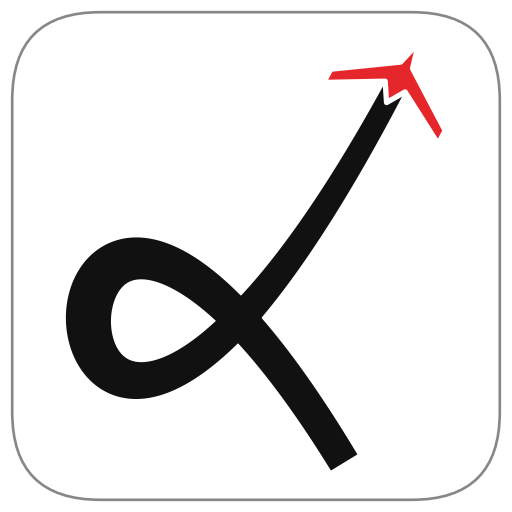
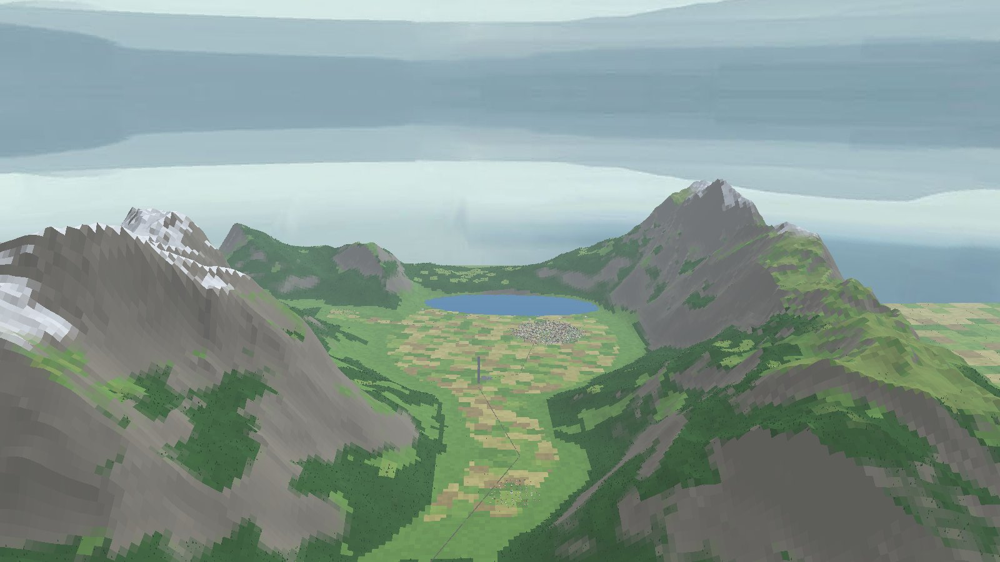

<p align="center"></p>

# Симулятор самолётного БПЛА

Симулятор небольшого беспилотного самолёта на Python. Физика, аэродинамика, САУ и
интегратор написаны с нуля, без сторонних движков, поэтому любую формулу можно найти
в коде и проверить. На нём можно:

- **полетать** в 3D вручную или под управлением САУ — по маршруту, с ветром и
  турбулентностью, над одной из четырёх карт;
- **изучить САУ**: на стенде коэффициенты регуляторов меняются ползунками прямо в
  полёте, а в конструкторе контур можно собрать из блоков ТАУ;
- **посчитать**: сценарии s1–s11 записывают полёт в `.flightlog`, по нему строятся
  графики и проверка против линейной теории.

<p align="center">
  
  
</p>

---

## Установка

```bash
git clone https://github.com/der-rozanov/Sim
cd Sim
pip install -r requirements.txt
```

Проверено на Python 3.12.10 и Windows 11, версии пакетов в `requirements.txt`
закреплены. Для расчётов нужны только `numpy` и `matplotlib`, `scipy` нужен для LQR,
`ursina` — для 3D-окон.

## С чего начать

```bash
python launcher.py
```

Лаунчер — окно, в котором выбирается режим (полёт, стенд, конструктор, сценарий,
просмотр лога), тип ЛА, карта, ветер и датчики. Он собирает командную строку и
запускает нужный скрипт. Без лаунчера то же самое запускается напрямую:

```bash
python scenarios/GameScenario3D.py      # полёт в 3D + окно наземной станции
python scenarios/Bench3D.py             # стенд САУ: блок-схемы с ползунками
python scenarios/BlockLab3D.py          # конструктор САУ из блоков
python scenarios/s10_waypoints.py       # любой сценарий s1–s11: расчёт + графики
python viz/viewer.py                    # графики последнего .flightlog
python viz/viewer3d.py                  # тот же полёт в 3D
python checks/check.py                  # самопроверка: ALL CHECKS PASSED
```

### Управление в 3D

| Клавиша | Вручную | С САУ (P — вкл/выкл) |
|---|---|---|
| W / S | руль высоты | уставка тангажа / высоты |
| A / D | элероны | уставка путевого угла ∓10° |
| Q / E | руль направления | — |
| X / Z | тяга | уставка скорости |
| Shift | большие расходы рулей | — |
| H / N | — | удержание высоты / полёт по маршруту |

Пробел — пауза, R — сброс, T — турбулентность, 1–4 — камера, F1 — вид HUD, Esc — выход.

Маршрут задаётся на карте окна станции: ЛКМ ставит или перетаскивает точку, ПКМ
удаляет, колесо над точкой меняет её высоту. Кнопка `FLY` отправляет ЛА по маршруту.
Подробнее — [docs/viewer3d.md](docs/viewer3d.md) и
[руководство пользователя](docs/USER_GUIDE.md).

---

## Что внутри

**Модель ЛА.** Полная модель 6DOF; ориентация задаётся кватернионом, поэтому
вертикальный полёт и петля не создают особенностей. Аэродинамика со срывом на
закритических углах атаки, мотор и винт по паспортным и продувочным данным, приводы
рулей с инерцией и пределом скорости, шасси и твёрдая земля. Ветер постоянный, с
порывами и сдвигом по высоте, плюс турбулентность Драйдена.

**САУ.** Коэффициенты всех контуров не подбираются вручную, а рассчитываются по модели
ЛА: для другого ЛА достаточно вызвать тот же расчёт.
- тангаж — каскад θ → q → δe; высота и скорость — TECS (управление полной энергией)
  или раздельные контуры; LQR как альтернатива;
- крен и курс по схеме PX4/ArduPilot, координированный разворот, полёт при боковом
  ветре;
- полёт по точкам со скруглением углов и кружением над последней точкой
  (Beard & McLain, гл. 10–11);
- защита от выхода на закритический угол атаки (на рулёжке выключена);
- пилотаж по заданной траектории фигур: петля, бочка и др. — побочная разработка.

**Датчики и оценка состояния.** Гироскоп, акселерометр, магнитометр, барометр, ПВД и
GPS с шумом, дрейфом, своей частотой опроса и запаздыванием. Состояние оценивает
инерциальный фильтр Калмана по схеме PX4 EKF2. Его работу видно на вкладке ESTIMATOR
окна станции.

**Карты.** Четыре вымышленные местности 10×10 км: учебная с ВПП, долина реки, горы с
озером, болото.

---

## Сценарии

| | Что проверяется |
|---|---|
| s1–s3 | балансировочный полёт, кабрирование, пикирование |
| s4 | выход на срыв с индикацией угла атаки |
| s5–s6 | удержание высоты и воздушной скорости |
| s7 | LQR: набор, горизонт, снижение |
| s8–s9 | координированный разворот, боковой ветер |
| s10 | полёт по точкам в штиль и при ветре |
| s11 | пилотажный комплекс (фигуры 1–8) в штиль и при ветре |

Каждый сценарий печатает отчёт и открывает графики. Числа на прежнем ЛА —
[docs/scenarios_report.md](docs/scenarios_report.md).

## Самолёт по умолчанию

FPV-самолёт классической схемы размахом 1.8 м: масса 2 кг, крыло 1.8 × 0.25 м, мотор
T-Motor AT2814 900KV с винтом APC 11×7E. Крейсерская скорость 16 м/с, сваливание
≈ 7.5 м/с. Геометрия и масса — оценка, аэродинамические производные посчитаны по
геометрии учебными формулами (`checks/estimate_fpv_aero.py`). Параметры Aerosonde из
Beard & McLain доступны как пресет `aerosonde_params()`. Свой ЛА добавляется в `sim/config.py` (реестр `AIRCRAFT_TYPES`,
ключ `--aircraft`).

Все числа, которые выдаёт симулятор, — результаты моделирования, а не эксперимента.

---

## Как устроен код

```
sim/        физика: параметры ЛА, состояние, динамика, аэродинамика, ветер, земля
control/    САУ: регуляторы, датчики, EKF, TECS, навигация, пилотаж, расчёт коэффициентов
runner.py   главный цикл run() → Log, балансировка;  flight_logger.py — запись .flightlog
viz/        2D-графики, 3D-тренажёр, карты, окна станции, стенда и конструктора
scenarios/  сценарии s1–s11 и интерактивные режимы
checks/     проверки: знаки, моды, сверка с линейной теорией
archive/    сравнение «зонд vs косвенная оценка УА» (тема диплома, на паузе)
docs/       документация
launcher.py окно запуска
```

Каждый слой знает только о нижележащих. Физика — чистая функция
`derivatives(state, controls, t)`, отделённая от интегратора (RK4, Эйлер). Состояние
хранится в одном numpy-векторе с именованными индексами. Все параметры вынесены в
конфиг, а графики не смешиваются с расчётом.

## Документация

| | |
|---|---|
| [USER_GUIDE.md](docs/USER_GUIDE.md) | руководство пользователя с иллюстрациями |
| [physics.md](docs/physics.md) | уравнения движения, системы координат, знаки |
| [aerodynamics.md](docs/aerodynamics.md) | аэродинамические коэффициенты, собственные движения |
| [control.md](docs/control.md) | САУ, EKF, навигация, пилотаж: схемы и расчёт |
| [SENSORS.md](docs/SENSORS.md) | модели датчиков |
| [viewer3d.md](docs/viewer3d.md) | 3D-тренажёр, карты, стенд, окно станции |
| [decisions.md](docs/decisions.md) | почему сделано именно так |
| [DEV_PLAN.md](docs/DEV_PLAN.md) | что делать дальше, известные дефекты |

Полная карта — [docs/README.md](docs/README.md).

## Дальше

Численная балансировка для набора, снижения и виража; модальный анализ; траектории
Дубинса; демпфер рыскания без датчика скольжения; запись оценки EKF в `.flightlog`.
Подробности — [docs/DEV_PLAN.md](docs/DEV_PLAN.md).

---

Проект начинался как инструмент магистерской работы по измерению аэродинамических
углов БПЛА, а теперь развивается как самостоятельный симулятор.
