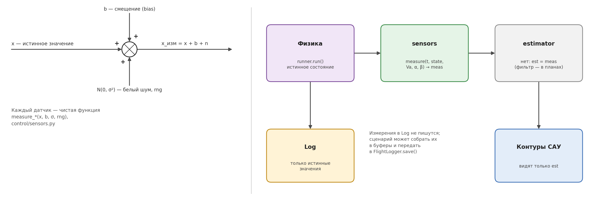
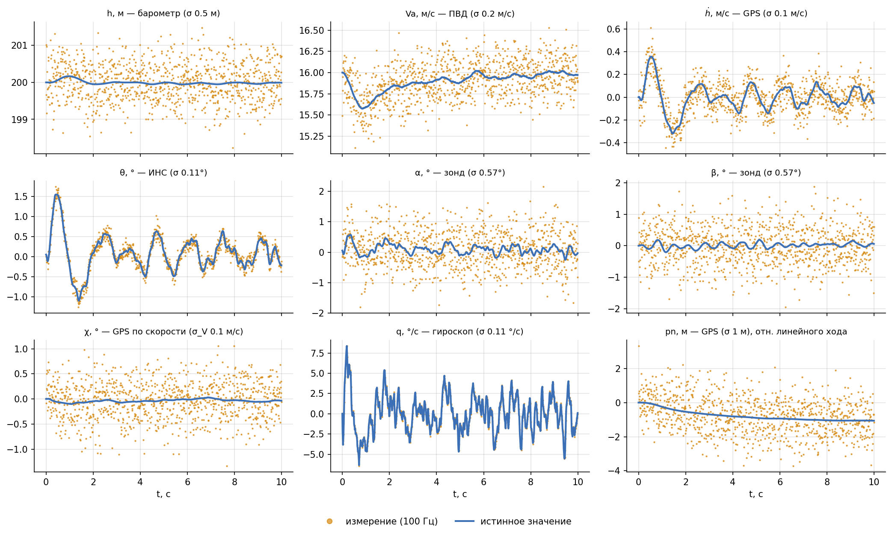
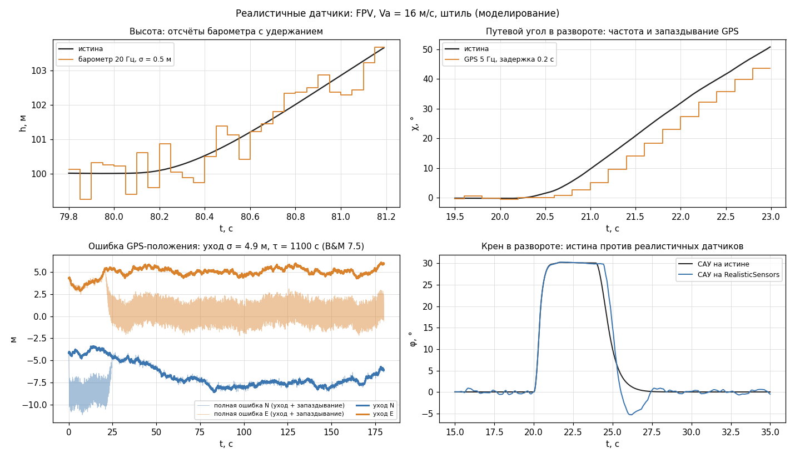

# Псевдодатчики

Как САУ симулятора «видит» самолёт: модель датчиков, их параметры, какие измерения
получает каждый контур и как шум датчиков сказывается на полёте. Сама САУ — в
[control.md](control.md).

Числа — для FPV-самолёта на 16 м/с, результаты **моделирования**. Графики считает
[`docs/figures/sau_plots.py`](figures/sau_plots.py), схему рисует
[`docs/figures/sau_diagrams.py`](figures/sau_diagrams.py).

---

## 1. Модель датчика



Каждый датчик — чистая функция `control/sensors.py`:

$$
x_{изм} = x + b + n, \qquad n \sim \mathcal N(0,\ \sigma^2)
$$

где x — истинное значение, b — постоянное смещение (bias), n — белый гауссов шум,
независимый на каждом шаге. Шум берётся из генератора `rng` (`numpy.random.Generator`),
поэтому прогон с тем же `seed` воспроизводится до бита.

Физика (`runner.run`) считает **истинное** состояние; измерения получает только САУ.
В журнал `Log` пишутся только истинные значения — если нужны измерения, сценарий
собирает их сам и передаёт в `FlightLogger.save(...)`.

---

## 2. Датчики и параметры

Параметры — `sim.config.SensorParams`. Источник — B&M, приложение H, если не сказано
иное; поля с пометкой [АВТОР] — характеристики конкретного изделия, их задаёт автор.

| Датчик | Функция | Что измеряет | Шум σ (`SensorParams`) | Смещение |
|---|---|---|---|---|
| Гироскоп | `measure_gyro` | угловую скорость p, q или r | `gyro_noise` = 0.002 рад/с (0.11 °/с) | `gyro_bias` = 0 |
| ИНС | `measure_attitude` | угол φ, θ или ψ | `ins_angle_noise` = 0.002 рад (0.11°) [модель] | 0 |
| Барометр | `measure_altitude` | высоту h | `baro_noise` = 0.5 м | `baro_bias` = 0 |
| ПВД (СВС) | `measure_airspeed` | воздушную скорость Va (≥ 0) | `airspeed_noise` = 0.2 м/с | `airspeed_bias` = 0 |
| Зонд, УА | `measure_angle_of_attack` | угол атаки α | `probe_noise` = 0.01 рад (0.57°) [АВТОР] | `probe_bias` = 0 [АВТОР] |
| Зонд, УС | `measure_sideslip` | угол скольжения β | `probe_beta_noise` = 0.01 рад (0.57°) [АВТОР] | `probe_beta_bias` = 0 [АВТОР] |
| GPS, путевой угол | `measure_gps_course` | χ = atan2(V_E, V_N) | шум на составляющие скорости `gps_vel_noise` = 0.1 м/с | — |
| GPS, координаты | в `NoisySensors` | pn, pe | `gps_pos_noise` = 1 м | — |
| GPS, вертикальная скорость | в `NoisySensors` | ḣ | `gps_vel_noise` = 0.1 м/с | — |
| GPS, скорость (продольная) | `measure_gps_velocity_earth` | (V_x, V_h) в вертикальной плоскости | `gps_vel_noise` | кортеж или число |

Особенности:

- **Путевой угол GPS.** Шум добавляется к составляющим земной скорости, как у приёмника, а
  затем считается угол. Поэтому шум угла зависит от скорости: σ_χ ≈ σ_V/Vg = 0.36° на
  16 м/с и растёт при малой путевой скорости (встречный ветер).
- **χ и ψ — разные углы.** При ветре путевой угол χ (куда летим над землёй) отличается
  от курса ψ (куда смотрит нос) на угол сноса. САУ держит линию пути по χ от GPS, а не по
  ψ от ИНС ([physics.md, раздел 1.4](physics.md#14-воздушная-скорость-угол-атаки-и-угол-скольжения)).
- **α и β — по воздушной скорости.** Зонд измеряет аэродинамические углы относительно
  воздуха, с учётом ветра; косвенная оценка α = θ − γ по ИНС и GPS при ветре ошибается
  (тема зонда на паузе, [archive/probe/REPORT.md](../archive/probe/REPORT.md)).
- **Путевая скорость Vg** в `NoisySensors` — истинная: она только масштабирует уставку
  крена, и её шум на полёт не влияет.

---

## 3. Наборы датчиков для САУ

Класс `SAU` получает измерения от объекта-набора с методом
`measure(t, state, Va, α, β) → meas` ([control.md, раздел 9](control.md#9-сау-одним-классом--sau)).

| Класс | Где используется | Что даёт |
|---|---|---|
| `NoisySensors(sp, rng, gps_pos, alpha_probe, gps_vz)` | сценарии s8–s10 | псевдодатчики с шумом и смещением |
| `TruthSensors()` | 3D-тренажёр, стенд, конструктор (по умолчанию) | те же ключи, истинные значения |
| `RealisticSensors(sp, rng, accel_fn)` | 3D-режимы с `--sensors real` | частоты, запаздывание GPS, дрейф, акселерометр — [раздел 7](#7-реалистичный-набор-датчиков-3d) |

Что получает каждый контур:

| Ключ `meas` | Датчик | Флаг `NoisySensors` | Кто использует |
|---|---|---|---|
| `h` | барометр | всегда | TECS, ПИ высоты |
| `hdot` | GPS, вертикальная скорость | `gps_vz=True` (по умолчанию) | TECS |
| `Va` | ПВД | всегда | TECS, ПИ скорости, масштаб тангажа и крена |
| `theta`, `q` | ИНС, гироскоп | всегда | тангаж |
| `phi`, `p` | ИНС, гироскоп | всегда | крен |
| `chi`, `Vg` | GPS | всегда | курс |
| `beta` | зонд УС | всегда | скольжение (руль направления) |
| `alpha` | зонд УА | `alpha_probe=True` | защита по α |
| `pn`, `pe` | GPS, координаты | `gps_pos=True` | навигатор |
| `t` | — | всегда | — |

**Порядок вызовов генератора закреплён.** Обязательные измерения берутся первыми, а
необязательные — в конце. Поэтому прогоны с разными флагами (например, с навигатором и
без) получают одинаковый шум общих датчиков, и их можно честно сравнивать.

---

## 4. Как выглядят измерения

Установившийся полёт на 16 м/с, полная САУ, все датчики с шумом (100 Гц):



СКО ошибки измерения на этом прогоне совпадает с заданным σ: h 0.51 м, Va 0.20 м/с,
ḣ 0.10 м/с, θ 0.11°, q 0.11 °/с, α 0.58°, β 0.58°, χ 0.37°, pn 1.0 м.

Видно, насколько разные датчики «шумные» относительно самого сигнала: гироскоп и ИНС
почти точны, а зонд и путевой угол GPS в установившемся полёте дают шум больше самого
изменения величины. Поэтому коэффициент контура скольжения ограничен шумом зонда
(kp_β = 0.5, [control.md, раздел 6.2](control.md#62-скольжение)).

---

## 5. Как шум датчиков сказывается на полёте

Установившийся полёт 30 с, полная САУ (TECS). Чтобы найти, какой датчик за что отвечает,
шум отключался по одному:

| Шум | σ θ | σ q | σ φ | σ δe | σ газа | σ δr |
|---|---|---|---|---|---|---|
| все датчики | 0.27° | 1.8 °/с | 0.10° | 0.24° | 0.018 | 0.15° |
| без шума ПВД | 0.21° | 1.6 °/с | 0.09° | 0.23° | 0.014 | 0.14° |
| без шума барометра | 0.19° | 1.0 °/с | 0.09° | 0.11° | 0.013 | 0.14° |
| без шума GPS | 0.28° | 1.8 °/с | 0.02° | 0.24° | 0.018 | 0.12° |
| без шума зонда УС | 0.28° | 1.9 °/с | 0.10° | 0.26° | 0.018 | 0.07° |

Высота и скорость при этом держатся с СКО 0.03 м и 0.03 м/с — шум почти не сказывается на
траектории, только на работе рулей.

- **Барометр → тангаж.** Самый заметный источник в продольном канале. Шум высоты 0.5 м
  через контур высоты TECS даёт шум ḣ_ref ≈ 0.25 м/с, а он через упреждение γ_ff попадает
  прямо в уставку тангажа. Без шума барометра колебания руля высоты вдвое меньше.
- **ИНС → тангаж.** Оставшиеся колебания q (≈ 1 °/с) — шум тангажа ИНС 0.11°, умноженный
  на Kθ = 16 1/с.
- **GPS → крен.** Шум путевого угла даёт почти весь шум крена.
- **Зонд УС → руль направления.** Половина колебаний руля направления — от шума β.

Отсюда понятно, где пригодится оценка состояния (комплементарный фильтр высоты по
барометру и акселерометру — первым).

---

## 6. Использование вне `SAU`

Сценарии s1–s7 вызывают функции датчиков напрямую:

```python
import numpy as np
from sim.config import SensorParams
from sim.state import Q, H
from control.sensors import measure_gyro, measure_altitude

sp  = SensorParams(gyro_noise=0.005)            # свои параметры шума
rng = np.random.default_rng(seed=42)            # воспроизводимость — через seed

def controls_fn(t, state, Va, alpha):
    q_meas = measure_gyro(state[Q], sp.gyro_bias, sp.gyro_noise, rng)
    h_meas = measure_altitude(state[H], sp.baro_bias, sp.baro_noise, rng)
    ...
```

Для полной САУ — `NoisySensors(sp, rng, gps_pos=True)` в конструкторе `SAU`.

Чтобы сравнение двух вариантов САУ было честным, создавайте генератор заново с тем же
`seed` для каждого прогона — тогда шум общих датчиков у них одинаковый. Так же устроен
`RollHold`: у него свой генератор, чтобы удержание крена не сдвигало шум продольных
датчиков сценария.

---

## 7. Реалистичный набор датчиков (3D)

`control/sau.RealisticSensors` — набор для 3D-режимов (`--sensors real`; по умолчанию в 3D —
истина). В сценариях s1–s10 не используется. Отличия от `NoisySensors`:

| Что | Модель | Параметры `SensorParams` [АНАЛОГ] |
|---|---|---|
| Частоты отсчётов | отсчёт раз в 1/f, между отсчётами выход удерживается | `imu_rate` 100 Гц (гироскоп, акселерометр, ИНС, зонд), `baro_rate` 20 Гц, `airspeed_rate` 20 Гц, `gps_rate` 5 Гц |
| Запаздывание GPS | на выход идёт последнее решение, взятое не позже t − τ | `gps_delay` = 0.2 с |
| Смещение гироскопа | остаток калибровки (случайный, постоянный в полёте) + дрейф — марковский процесс 1-го порядка | `gyro_bias0` = 0.3 °/с; `gyro_drift_sigma` = 0.05 °/с, `gyro_drift_tau` = 300 с |
| Акселерометр (новый) | удельная сила в связанной СК + смещение + шум | `accel_noise` = 0.025 м/с² (0.0025 g, B&M 7.1), `accel_bias0` = 0.05 м/с² |
| Координаты GPS | медленный уход — марковский процесс (B&M 7.5) + белый шум | `gps_pos_drift_sigma` = 4.9 м, `gps_pos_drift_tau` = 1100 с, `gps_pos_white` = 0.2 м |
| χ, Vg, ḣ | по GPS-скорости с шумом (у `NoisySensors` Vg — истинная) | `gps_vel_noise` = 0.1 м/с |
| θ, φ | «ИНС» — истина + шум, как раньше; заменит EKF (DEV_PLAN 5.3) | `ins_angle_noise` |

Источник чисел — аналоги: MEMS класса MPU-6000 / ICM-20602, u-blox M8, MS5611, B&M гл. 7.
Для своего ЛА их заменяют паспортными данными датчиков.

**Марковский процесс 1-го порядка** (процесс Гаусса — Маркова) — модель медленного
дрейфа: $\dot b = -b/\tau + w$. В дискретной форме (точной при любом шаге T)

$$
b_{k+1} = e^{-T/\tau}\, b_k + \sigma\sqrt{1 - e^{-2T/\tau}}\; n_k,\qquad n_k \sim \mathcal N(0, 1),
$$

σ — установившееся СКО, τ — время корреляции: за τ корреляция падает до 1/e. Для GPS
(B&M 7.5: k = 1/1100 1/с, σ_η = 0.21 м при Ts = 1 с) установившееся СКО ухода
$0.21/\sqrt{1 - e^{-2/1100}} = 4.9$ м: положение «плывёт» на метры за минуты.

**Удельная сила** (что измеряет акселерометр в ЦМ) — `sim.dynamics.specific_force`:
сумма сил без веса, делённая на массу,

$$
\mathbf f = \dot{\mathbf V}_b + \boldsymbol\omega \times \mathbf V_b - \mathbf g_b,\qquad
\mathbf g_b = g\,(-\sin\theta,\ \cos\theta\sin\varphi,\ \cos\theta\cos\varphi).
$$

В установившемся горизонтальном полёте $|\mathbf f| = g$ (f_z ≈ −g: ось z — вниз), в
координированном вираже $|\mathbf f| = g/\cos\varphi$. Считается через `derivatives` с теми
же рулями, ветром и землёй, что у физики. Пока его никто не использует — он нужен EKF.

**Проверка** (`checks/check_sensors.py`, моделирование; FPV, Va = 16 м/с, штиль, SAU —
TECS + курс, разворот χ 0 → 90° на 20 с, набор h 100 → 130 м на 80 с, 180 с):

| Датчики | max \|e_χ\| 60…80 с | max \|Δh\| 140…180 с | СКО приращения δa / δe за шаг |
|---|---|---|---|
| истина | 0.02° | 0.00 м | 0.013° / 0.019° |
| `NoisySensors` (s8–s10) | 0.11° | 0.08 м | 0.077° / 0.174° |
| `RealisticSensors` | 0.40° | 0.31 м | 0.042° / 0.139° |



- Запаздывание GPS (0.2 с + до 0.2 с удержания при 5 Гц) — главное отличие: путевой угол
  отстаёт на 5–8° в развороте, на выходе из разворота крен перебрасывается до −5°
  (на истине — без перебега).
- Ошибка GPS-положения относительно текущей истины — сумма ухода (5–8 м за полёт) и
  запаздывания (16 м/с × 0.2…0.4 с ≈ 3–6 м вдоль пути).
- Рули дёргаются меньше, чем на `NoisySensors`: барометр и ПВД дают новый шум 20 раз
  в секунду, а не 100.
- Смещение гироскопа 0.1–0.3 °/с снимают интегралы контуров тангажа и крена.

## 8. Чего нет

- оценки состояния (фильтра): САУ работает прямо по измерениям; θ, φ «ИНС» — истина +
  шум (EKF — DEV_PLAN 5.3);
- дрейфа барометра и ПВД (смещение только постоянное);
- погрешностей, зависящих от режима (например, ошибки ПВД при скольжении);
- реалистичного набора в сценариях s1–s10 (решение автора: только 3D).

Каждое улучшение встаёт на место звена `sensors` или `estimator` класса `SAU`, не трогая
контуры.
