# Руководство пользователя

Симулятор самолётного беспилотника: модель полёта, система автоматического управления
(САУ), 3D-тренажёр, учебный стенд и конструктор САУ. Руководство рассказывает, как всем
этим пользоваться. Как устроены модель и САУ внутри — в справочниках
([physics.md](physics.md), [control.md](control.md)).

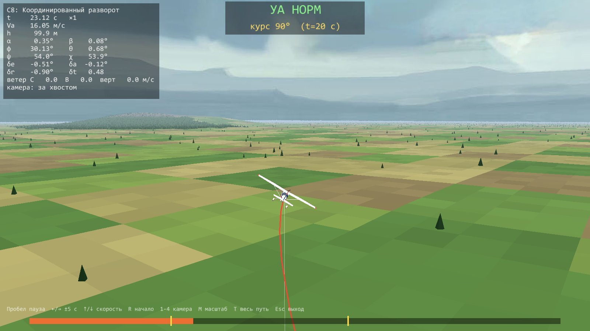

**Содержание**

1. [Что это за программа](#1-что-это-за-программа)
2. [Установка](#2-установка)
3. [Первый полёт за пять минут](#3-первый-полёт-за-пять-минут)
4. [3D-тренажёр](#4-3d-тренажёр)
5. [Полёт по маршруту](#5-полёт-по-маршруту)
6. [Стенд САУ](#6-стенд-сау)
7. [Конструктор САУ](#7-конструктор-сау)
8. [Сценарии s1–s10](#8-сценарии-s1s10)
9. [Просмотр записей полётов](#9-просмотр-записей-полётов)
10. [Свой сценарий](#10-свой-сценарий)
11. [Свой летательный аппарат](#11-свой-летательный-аппарат)
12. [Ограничения и частые вопросы](#12-ограничения-и-частые-вопросы)

---

## 1. Что это за программа

Симулятор рассчитывает полёт беспилотника самолётной схемы по полной модели движения
твёрдого тела с шестью степенями свободы (6DOF): три поступательных и три вращательных
движения, аэродинамика с выходом на срыв, электромотор с винтом, приводы рулей, шасси.
Поверх модели работает САУ: удержание высоты и скорости, развороты, полёт по точкам.
Её контуры построены по тем же схемам, что в открытых автопилотах PX4 и ArduPilot,
а коэффициенты рассчитываются по модели аппарата.

Всё написано на Python с нуля, без сторонних физических движков. Каждую формулу можно
открыть и прочитать — для этого симулятор и задуман.

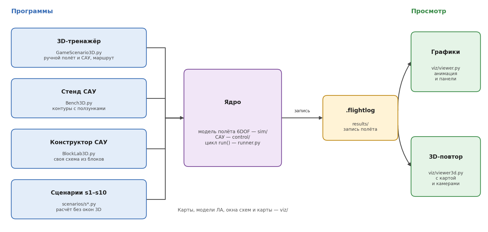

| Программа | Для чего | Запуск |
|---|---|---|
| **3D-тренажёр** | полетать самому или под САУ, проложить маршрут | `python scenarios/GameScenario3D.py` |
| **Стенд САУ** | увидеть, как устроены контуры управления, и покрутить их коэффициенты в полёте | `python scenarios/Bench3D.py` |
| **Конструктор САУ** | собрать свой регулятор из блоков и сразу испытать его | `python scenarios/BlockLab3D.py` |
| **Сценарии s1–s10** | готовые расчёты: балансировка, срыв, набор высоты, развороты, маршрут | `python scenarios/s1_steady_flight.py` и т. д. |
| **Просмотр графиков** | анимация и графики любого записанного полёта | `python viz/viewer.py` |
| **3D-повтор** | пересмотреть записанный полёт в 3D | `python viz/viewer3d.py` |

Каждая программа записывает полёт в файл `results/*.flightlog`. Его можно открыть
потом — графиками или в 3D.

**Аппарат по умолчанию** — FPV-самолёт классической схемы с размахом 1.8 м и массой 2 кг
(высокоплан, мотор T-Motor AT2814, винт APC 11×7). Крейсерская скорость — 16 м/с,
скорость сваливания — около 7.5 м/с. Геометрия и масса — оценка, характеристики
мотора и винта — паспортные и продувочные данные.

> **Важно.** Симулятор даёт результаты *моделирования*, а не эксперимента. Числа
> зависят от параметров модели, а они для конкретного аппарата всегда приближённые.

---

## 2. Установка

Нужен Python 3.10 или новее.

```bash
git clone https://github.com/der-rozanov/Sim
cd Sim
pip install numpy matplotlib scipy ursina
```

| Пакет | Для чего |
|---|---|
| `numpy`, `matplotlib` | всё: модель, расчёты, графики |
| `scipy` | только регулятор LQR (сценарий s7) |
| `ursina` | только 3D: тренажёр, стенд, конструктор, 3D-повтор |

Проверка установки:

```bash
python checks/check.py
```

В конце должно быть `ALL CHECKS PASSED`.

> **Карты Каинки.** При первом запуске с картой `kainki*` программа скачивает
> спутниковый снимок и рельеф местности в папку `viz/map_cache/` — нужен интернет,
> занимает от минуты (`kainki`) до нескольких минут (`kainki_large`). Потом всё
> берётся из папки. Учебная карта `default` ничего не скачивает.

---

## 3. Первый полёт за пять минут

```bash
python scenarios/GameScenario3D.py
```

Откроются два окна: 3D-вид и окно станции (приборы и карта). Самолёт летит горизонтально на высоте
100 м со скоростью 16 м/с над взлётной полосой, курсом на север, — двигатель и рули
уже стоят в положении равновесия.

1. **Покачайте крыльями.** Подержите `D` полсекунды — самолёт накренится вправо и начнёт
   поворачивать. `A` — обратно. Рули отклоняются, пока клавиша нажата, и сами
   возвращаются в среднее положение, как ручка пульта.
2. **Наберите высоту.** `S` — нос вверх, `X` — прибавить газ. Следите за скоростью `Va`
   и углом атаки `α` слева. Если `α` растёт, а скорость падает — самолёт близок к
   сваливанию: появится рамка **AOA … WARN**, затем **CRIT**, **STALL**.
3. **Включите автопилот.** `P` — САУ включается и держит текущие тангаж, скорость и курс.
   `H` — удерживать высоту. Теперь `W`/`S` меняют заданную высоту на ∓10 м, `A`/`D` — курс
   на ∓10°, `X`/`Z` — скорость на ±1 м/с.
4. **Пролетите по маршруту.** На карте окна станции щёлкните мышью три-четыре точки и
   нажмите `FLY` — подробно в [разделе 5](#5-полёт-по-маршруту).
5. **Выйдите** — `Esc`. Полёт сохранится в `results/Sim_Игра_3D_<время>.flightlog`.
   Пересмотреть его в 3D: `python viz/viewer3d.py` (откроется последний записанный полёт).

---

## 4. 3D-тренажёр

```bash
python scenarios/GameScenario3D.py [--map КАРТА] [--wind-n СЕВЕР] [--wind-e ВОСТОК] [--turb УРОВЕНЬ] [--h0 ВЫСОТА] [--ap] [--cam 1..4] [--no-map]
```

| Параметр | Что задаёт | По умолчанию |
|---|---|---|
| `--map` | карта (см. ниже) | `default` |
| `--wind-n`, `--wind-e` | постоянный ветер на север и на восток, м/с | 0 |
| `--turb` | турбулентность: `off`, `light` (слабая), `moderate` (умеренная); в полёте — клавиша `T` | `off` |
| `--turb-alt` | параметры турбулентности для высоты 50 м (`low`) или 600 м (`medium`) | `low` |
| `--sensors` | датчики САУ: `real` — реалистичные (частоты, запаздывание GPS, дрейф, [SENSORS.md, 7](SENSORS.md)) или `truth` — истинные значения | `real` |
| `--est` | при `--sensors real`: `ekf` — оценка состояния ([control.md, 9.3](control.md)), `none` — САУ на сырых измерениях | `ekf` |
| `--h0` | начальная высота, м | 100 |
| `--ap` | старт с включённой САУ | выключена |
| `--cam` | камера на старте | 1 |
| `--no-map` | не открывать окно станции | — |
| `--aircraft` | тип аппарата ([раздел 11](#11-свой-летательный-аппарат)) | `fpv` |

### Управление

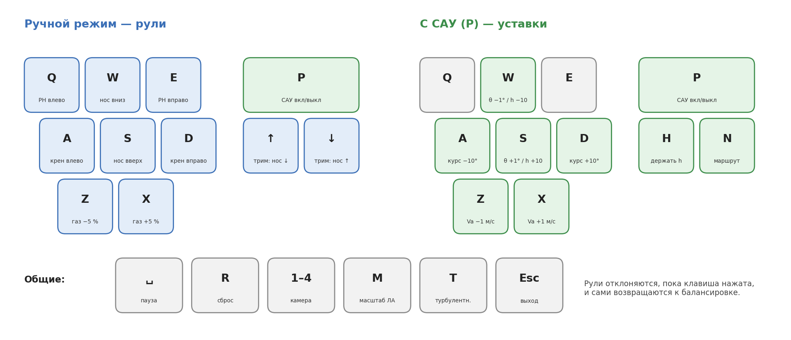

**Ручной режим.** Пока клавиша нажата, руль отклонён на фиксированный угол: руль высоты
±2°, элероны ±3°, руль направления ±3°. Отпущенная клавиша — руль плавно (20°/с)
возвращается к балансировочному положению. Стрелки `↑`/`↓` сдвигают балансировку руля
высоты (триммер) на 0.3°: подберите её, и самолёт будет держать высоту без нажатий.
`X`/`Z` меняют газ на 5 %, и газ остаётся там, где его оставили.

**Турбулентность** (`T`): выключена → слабая → умеренная → выключена. Порывы случайные,
по модели Драйдена ([physics.md, 4.5](physics.md)); круг ветра в HUD показывает их вживую.

**С САУ** (`P`). При включении САУ запоминает текущие тангаж, скорость и курс и держит их.
Клавиши меняют уже не рули, а *уставки* — то, что САУ должна выдержать. `H` переключает
удержание высоты, `N` — полёт по маршруту из окна карты. Повторное `P` возвращает ручное
управление.

### Что на экране

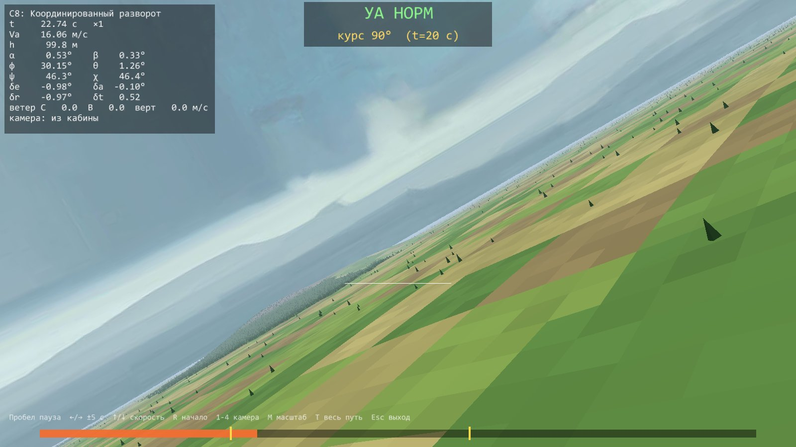

| Где | Что |
|---|---|
| сверху | строка режимов: `MAN` (ручное, триммер δe) или `AP TECS ALT 120 SPD 16.0 TRK 090` / `NAV → 2/5`; курсовая лента — курс `ψ` (галочка), путевой угол `χ` (ромб), уставка `χ_ref` (скоба) |
| в центре (камеры 1–2) | продольная ось самолёта («W»), маркер вектора воздушной скорости (кружок с крылышками) и линии тангажа. Маркер ниже оси на угол атаки `α`, в сторону — на угол скольжения `β` |
| слева | воздушная скорость `Va` (в скобках — уставка), газ, `α`, `β`, крен `φ`, путевой угол `χ` |
| справа | лента высоты `h` с уставкой и вертикальной скоростью |
| справа внизу | круг ветра: север вверху, стрелка — куда дует ветер, риска — курс самолёта |
| рамка над центром | только при большом угле атаки: **AOA … WARN**, **CRIT**, **STALL** |
| внизу | событие (авария, касание), подсказка по клавишам, камера. `F1` — уровень HUD: всё → режимы и предупреждения → пусто |
| в сцене | красный след — пройденный путь, тёмная линия на земле — его проекция, белая вертикаль — высота над землёй, жёлтая линия — маршрут |

**Камеры** (`1`–`4`): за хвостом; из кабины (с креном и тангажом самолёта); облёт —
правая кнопка мыши и движение поворачивают камеру, колесо приближает; сверху —
видна вся траектория. `M` — увеличить модель самолёта в 10 раз, чтобы видеть её издали.

### Земля, взлёт и посадка

Земля твёрдая на всех картах: самолёт стоит на трёхколёсном шасси, катится, взлетает и
садится. На земле `Q`/`E` поворачивают носовое колесо. С полного газа самолёт отрывается
примерно на 13 м/с после короткого разбега. Тормозов нет.

Полёт прерывается аварией, если:

- землю задели винт, крыло, хвост или фюзеляж («УДАР О ЗЕМЛЮ»);
- колесо коснулось земли быстрее 3 м/с по вертикали («ПОЛОМКА ШАССИ»);
- самолёт сел на воду («ПРИВОДНЕНИЕ», только на карте `default`).

`R` начинает полёт заново.

> **Совет.** Заход на посадку удобно начинать под САУ: удержание высоты (`H`), уставку
> высоты — клавишей `W` пониже над полосой, скорость — клавишей `Z` поменьше (сваливание
> около 7.5 м/с). У земли выключите САУ (`P`) и плавно выравнивайте самолёт клавишей `S`.

### Карты

| Карта | Что это | Размер |
|---|---|---|
| `default` | учебная: полоса, река, озеро, деревня, холм 150 м, леса | 10 × 10 км |
| `kainki` | аэродром Каинки (Татарстан): спутниковый снимок на реальном рельефе | 4 × 4 км |
| `kainki_osm` | те же 4 × 4 км, раскрашены по OpenStreetMap в стиле учебной карты | 4 × 4 км |
| `kainki_large`, `kainki_large_osm` | то же на 10 × 10 км | 10 × 10 км |

За краем любой карты — бесконечная равнина.

| `default` | `kainki_osm` | `kainki_large_osm` |
|---|---|---|
| 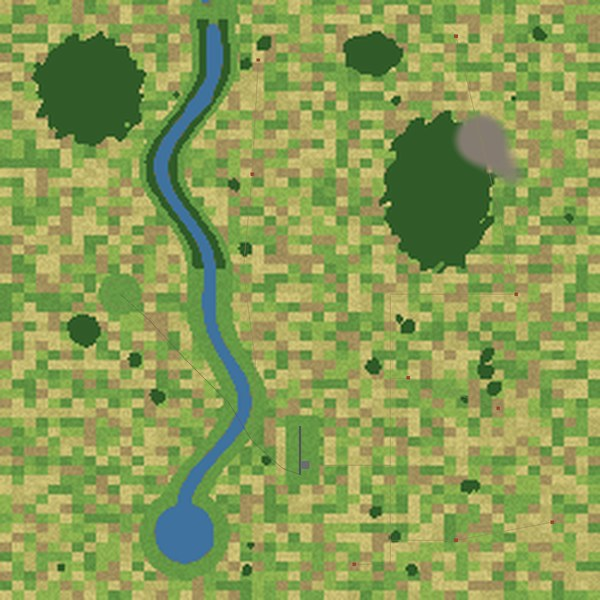 | 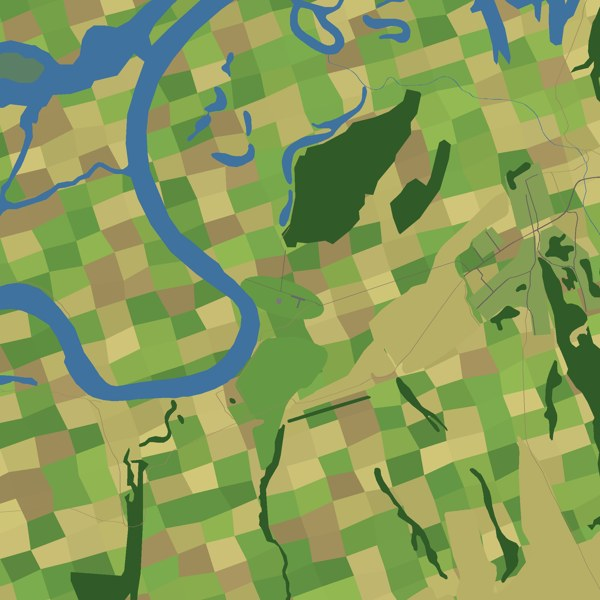 | 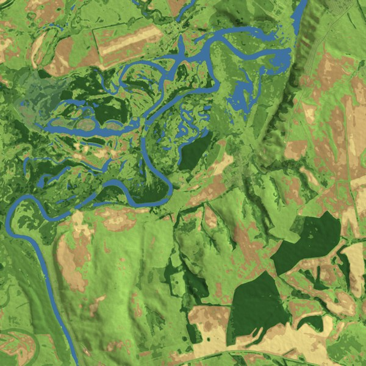 |

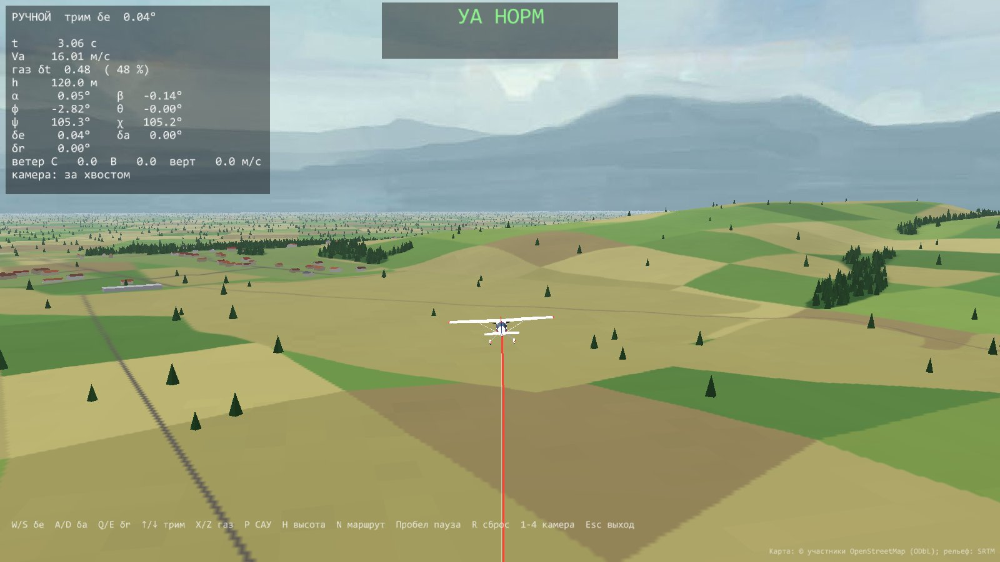

*Карты Каинки: © участники OpenStreetMap (ODbL), рельеф — SRTM. Спутниковый снимок карт
`kainki` и `kainki_large` — Esri World Imagery; по условиям Esri он не распространяется
и в документацию не включён.*

### Запись полёта

Каждый полёт длиннее 2 с сохраняется в `results/Sim_Игра_3D_<время>_<дата>.flightlog` —
при выходе (`Esc`) и при сбросе (`R`). В запись попадают события: включение и
выключение САУ, касание земли, авария.

---

## 5. Полёт по маршруту

Окно станции открывается вместе с тренажёром и стендом. Слева — пилотажный индикатор
(PFD): авиагоризонт, ленты скорости и высоты, курс, сверху — табло режимов САУ. В центре —
карта: вид сверху, самолёт (стрелка по курсу), его след и маршрут. Справа — рули, угол
атаки, энергия (TECS) и журнал событий. Подробно — docs/viewer3d.md, раздел 13.

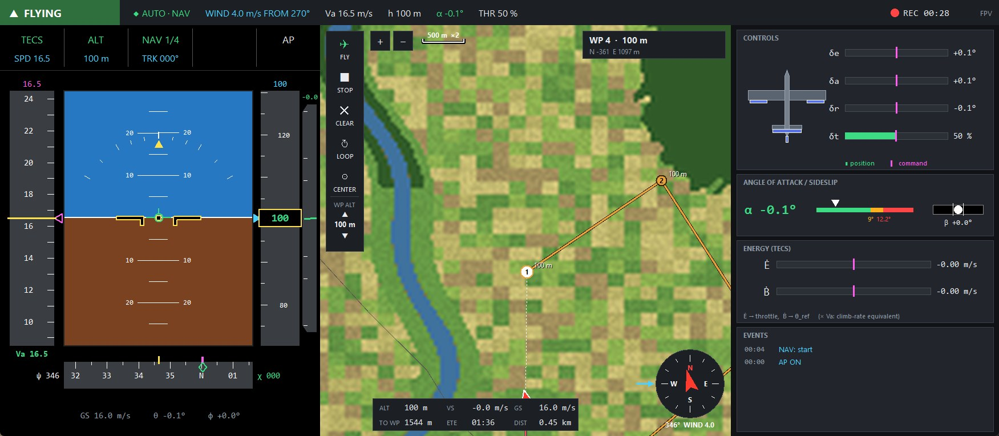

| Действие | Как |
|---|---|
| поставить точку в конец маршрута | щелчок левой кнопкой по пустому месту (высота — `WP ALT` на панели слева, ▲▼) |
| перенести точку | взять левой кнопкой и тянуть |
| удалить точку | правая кнопка по точке |
| высота точки ±10 м | колесо над точкой |
| приблизить / отдалить карту | колесо над картой или кнопки + − (×1, ×2, ×4) |
| сдвинуть карту | средняя кнопка; `CENTER` — вернуть самолёт в центр |
| полететь | `FLY` (или `N` в 3D) — САУ включится сама |
| прекратить | `STOP` (или `N`) — САУ держит текущие курс и высоту |
| замкнуть маршрут | `LOOP TRACK`; иначе после последней точки самолёт кружит над ней |

Вторая вкладка окна — `ESTIMATOR` (кнопка в строке статуса или клавиша Tab): как работает
фильтр, оценивающий положение, ориентацию и ветер по датчикам. Таблица сравнивает оценку с
истиной (в симуляторе она известна) и показывает границу ±3σ, в которой фильтр «считает»
свою ошибку; щелчок по строке — график этой ошибки за минуту. Слева — какие датчики
принимаются фильтром, а какие отбракованы (полоса дошла до риски), и сбросы фильтра.
Подробно — docs/viewer3d.md, раздел 13.

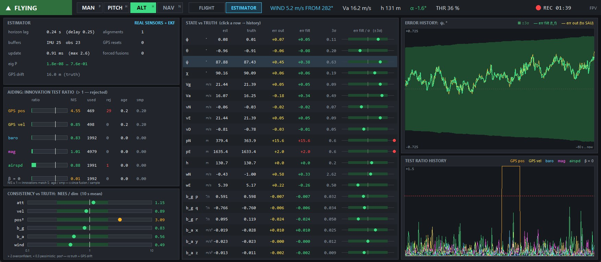

Самолёт летит по прямым между точками и срезает углы дугой радиусом 200 м — так
поворачивают настоящие автопилоты. На карте текущая цель — белая, внизу — расстояние
и время до неё; номер точки — на табло режимов (`NAV 2/4`). Маршрут можно править прямо в полёте. Ручные уставки
(`W`/`S`/`A`/`D`) выключают полёт по маршруту.

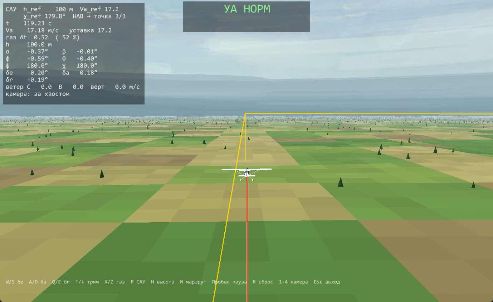

---

## 6. Стенд САУ

```bash
python scenarios/Bench3D.py [--map КАРТА] [--wind-n …] [--wind-e …] [--turb …] [--no-map]
```

Стенд — тот же 3D-полёт плюс окно со структурными схемами всех контуров САУ. На схемах
видны живые значения сигналов, под ними — ползунки коэффициентов и осциллограф за
последние 20 с. Любой ползунок применяется сразу — эффект виден в 3D и на графиках.
Самолёт стартует на высоте 200 м с включённой САУ.

Сама САУ устроена так: датчики дают измерения; навигатор (если летим по маршруту)
превращает маршрут в заданные курс и высоту; TECS по высоте и скорости считает газ и
нужный тангаж; защита по углу атаки при необходимости этот тангаж ограничивает;
внутренние контуры превращают заданные тангаж и курс в отклонения рулей.

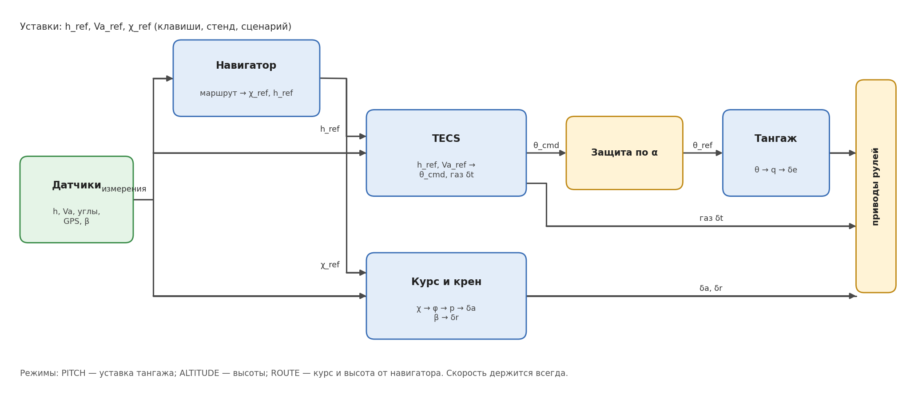

Каждый блок этой схемы раскрыт на своей вкладке стенда.

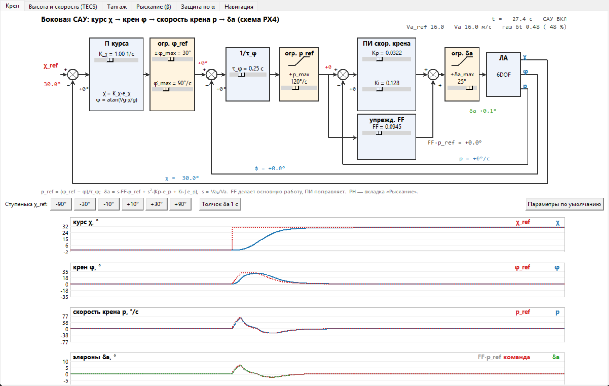

На снимке — реакция на кнопку «+30°»: уставка курса `χ_ref` прыгнула на 30°, САУ дала
крен до 30° (это предел), развернула самолёт и вернула крылья в горизонт; курс плавно
вышел на новое значение без заметного перерегулирования.

| Вкладка | Что на схеме | Что можно сделать |
|---|---|---|
| **Крен** | курс → заданный крен → заданная скорость крена → элероны | ступеньки курса ±10°, ±30°, ±90°; толчок элеронами |
| **Высота и скорость (TECS)** | управление полной энергией: газ отвечает за энергию, руль высоты — за её раздел между высотой и скоростью | ступеньки высоты ±10/±50 м и скорости ±1/±5 м/с |
| **Тангаж** | заданный тангаж → угловая скорость → руль высоты | толчок рулём высоты |
| **Рыскание (β)** | удержание нулевого скольжения рулём направления | толчок рулём направления |
| **Защита по α** | автомат защиты от выхода на закритические углы атаки | «Срыв» — бросить газ и задрать нос; включить/выключить защиту |
| **Навигация** | маршрут → следование по линии → курс и высота | радиусы поворота и кружения, «Лететь по маршруту» |

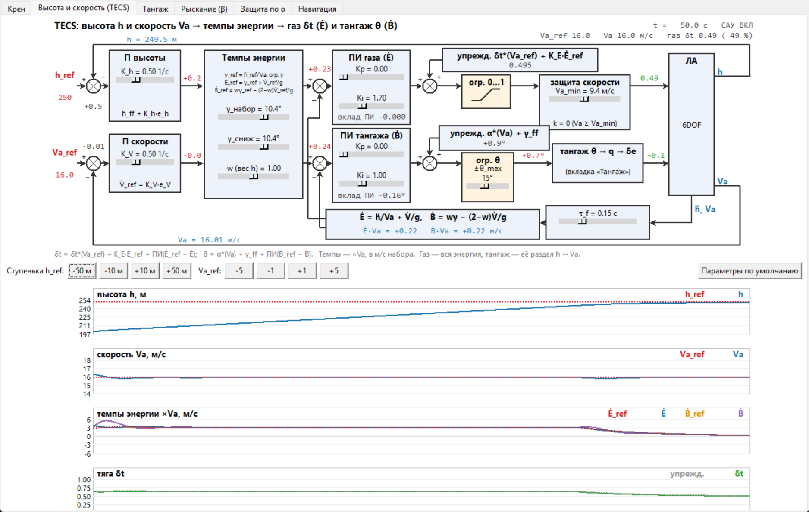

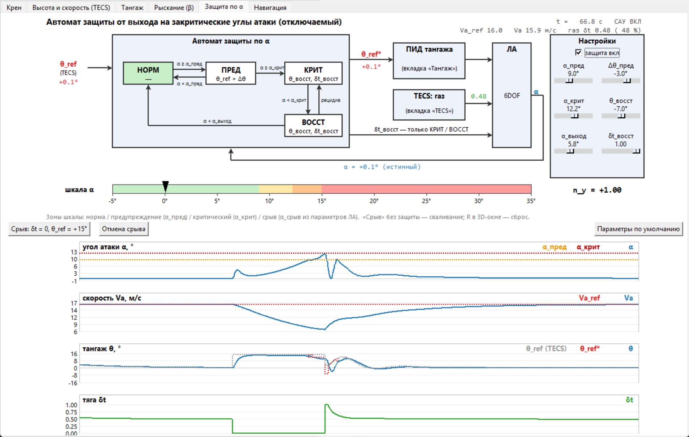

На последнем снимке нажата кнопка «Срыв»: газ ноль, нос вверх. Скорость падает с 16 до
7 м/с, угол атаки растёт. Как только `α` дошёл до критического (12.2°), автомат защиты
перехватил управление: опустил нос, дал полный газ и вернул самолёт в нормальный полёт.
Снимите флажок «защита вкл» и повторите — самолёт свалится.

> **Упражнения.**
> 1. Вкладка «Крен»: уменьшайте `Kp` скорости крена — переходный процесс станет вялым;
>    увеличивайте — появятся колебания.
> 2. Вкладка «Крен»: поставьте `±φ_max` = 10° и дайте ступеньку +90°. Сравните время
>    разворота со штатными 30°. Как радиус разворота зависит от крена?
> 3. Вкладка «TECS»: дайте ступеньку высоты +50 м, затем скорости +5 м/с. Посмотрите,
>    как каждая команда раскладывается на газ и тангаж, и сравните с разделом 4 control.md.
> 4. Вкладка «Защита по α»: найдите, при каком `α_крит` защита начинает срабатывать в
>    обычных разворотах.

«Параметры по умолчанию» на каждой вкладке возвращают штатные коэффициенты.

---

## 7. Конструктор САУ

```bash
python scenarios/BlockLab3D.py [--template "ШАБЛОН"] [--scheme файл.json] [--map …] [--wind-n …] [--wind-e …] [--turb …]
```

В конструкторе вы сами собираете регулятор из блоков — как в Simulink — и он сразу
управляет самолётом в 3D. Схема может вести любые из четырёх органов управления:
руль высоты `δe`, газ `δt`, элероны `δa`, руль направления `δr`. Остальными управляет
штатная САУ, поэтому каналы можно заменять по одному.

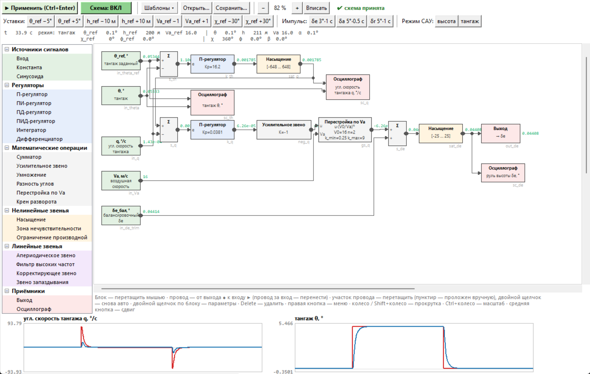

### Как работать

1. **Начните с шаблона.** Меню «Шаблоны»:
   - «Заготовка: …» — только входы и выход канала, регулятора нет — соберите его сами;
   - «Штатная САУ: …» — штатный регулятор, собранный из блоков, — работает так же, как
     встроенный.
2. **Соберите схему.** Слева — библиотека: щёлкните блок, затем место на схеме.
   Провод тянется от выхода блока (●) к входу другого (▶). Двойной щелчок по блоку —
   его параметры. `Delete` — удалить выделенное.
3. **Нажмите «Применить»** (`Ctrl+Enter`). Схема проверяется и передаётся в 3D; ошибки
   (неподключённый вход, петля без задержки) показываются сверху.
4. **Включите схему** — кнопка «Схема: ВЫКЛ» станет «Схема: ВКЛ», и выходы схемы пойдут на
   рули. Если схема выдаст бесконечность или NaN, она выключится сама, а управление
   вернётся штатной САУ.
5. **Испытайте.** Кнопки «Уставки» дают ступеньки, «Импульс» — короткий толчок рулём,
   «Режим САУ» переключает удержание высоты и тангажа. Графики — в блоках «Осциллограф»
   (до четырёх на схеме).
6. **Сохраните** схему в `.json` («Сохранить…») и открывайте потом («Открыть…» или
   `--scheme файл.json` при запуске).

Масштаб схемы — `Ctrl` + колесо, «Вписать» — показать всю схему, средняя кнопка — сдвиг.

### Библиотека блоков

| Группа | Блоки |
|---|---|
| Источники сигналов | Вход (сигналы самолёта и уставки), Константа, Синусоида |
| Регуляторы | П, ПИ, ПД, ПИД, Интегратор, Дифференциатор |
| Математические операции | Сумматор, Усилительное звено, Умножение, Разность углов, Перестройка по Va, Крен разворота |
| Нелинейные звенья | Насыщение, Зона нечувствительности, Ограничение производной |
| Линейные звенья | Апериодическое звено, Фильтр высоких частот, Корректирующее звено, Звено запаздывания |
| Приёмники | Выход (на руль), Осциллограф |

Сигналы блока «Вход»: заданные и текущие тангаж `θ`, высота `h`, скорость `Va`, крен `φ`,
курс `χ`; угловые скорости `q`, `p`, `r`; вертикальная скорость; углы атаки `α` и
скольжения `β`; путевая скорость; балансировочные положения рулей и газа.

> **Задание для начала.** Шаблон «Заготовка: тангаж → δe». Поставьте между сумматором
> и выходом П-регулятор с `Kp` = 1, включите схему, режим «тангаж», ступенька `θ_ref`
> +5°. Самолёт раскачивается — почему? Добавьте внутренний контур по угловой скорости
> `q` и сравните со «Штатной САУ: тангаж».

---

## 8. Сценарии s1–s10

Сценарии — готовые расчёты без 3D: каждый прогоняет модель, печатает итоги в консоль,
сохраняет `.flightlog` и показывает анимированные графики.

```bash
python scenarios/s4_stall.py               # показать
python scenarios/s4_stall.py out.gif       # показать и сохранить анимацию в GIF (или .mp4)
```

| Сценарий | Что происходит | На что смотреть |
|---|---|---|
| `s1_steady_flight` | 30 с горизонтального полёта на неизменных рулях | всё постоянно — модель сбалансирована |
| `s2_pitch_up` | команда тангажа +5°, через 20 с — возврат | как быстро тангаж выходит на уставку; самолёт набирает высоту |
| `s3_pitch_down` | команда тангажа −5°, через 10 с — возврат | снижение и разгон |
| `s4_stall` | газ ноль, тангаж 20° — сваливание; через 17 с — вывод | индикатор угла атаки ПРЕД → КРИТ → СРЫВ, потеря высоты |
| `s5_altitude_control` | набор 100 → 200 м, затем снижение | высота следует за уставкой, скорость держит газ |
| `s6_speed_control` | то же + разгон до 20 м/с | одновременная смена высоты и скорости |
| `s7_lqr_climb` | набор 100 → 150 м, горизонт, снижение — регулятор LQR | точность удержания высоты на горизонтальном участке |
| `s8_coordinated_turn` | развороты 0° → 90° → −45° | крен до 30°, скольжение `β` около нуля |
| `s9_crosswind` | боковой ветер 5 м/с, затем разворот | самолёт держит линию пути, разворачивая нос против ветра |
| `s10_waypoints` | полёт по четырём точкам, в штиль и при ветре | дуги на углах маршрута, кружение у последней точки |

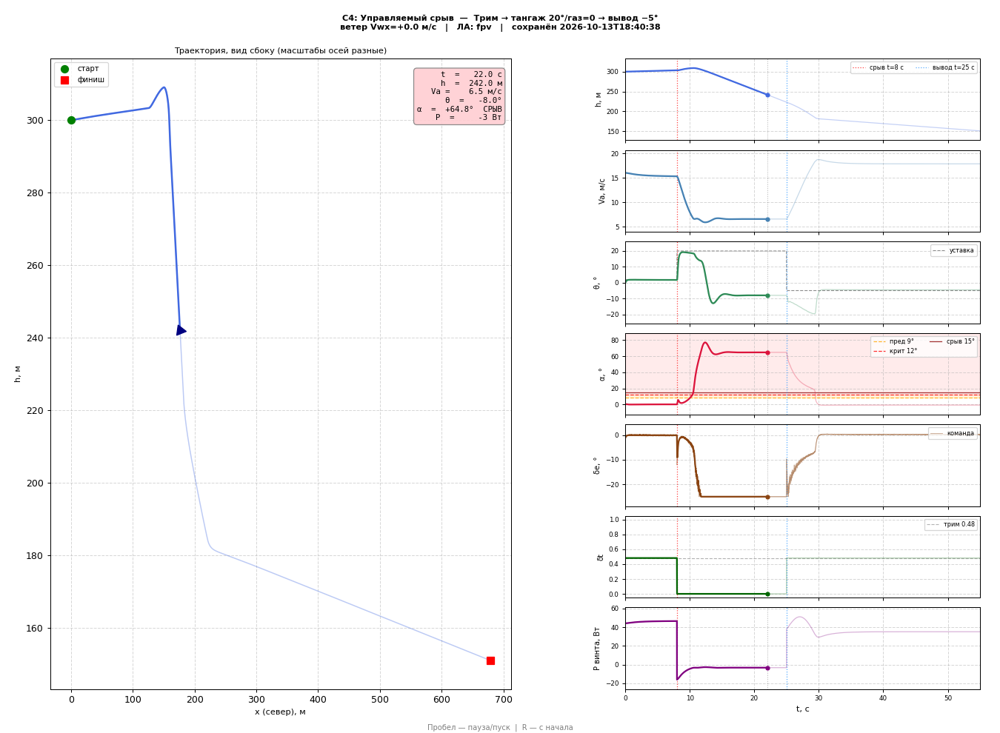

Параметры сценария — константы в начале его файла (время команд, уставки, ветер):
поменяйте и запустите снова.

---

## 9. Просмотр записей полётов

### Графики и анимация

```bash
python viz/viewer.py                                  # выбрать файл в диалоге
python viz/viewer.py results/<файл>.flightlog         # анимация
python viz/viewer.py <файл> --static                  # сразу все графики, без анимации
python viz/viewer.py <файл> --speed 4                 # быстрее в 4 раза
python viz/viewer.py <файл> --save полёт.gif          # сохранить анимацию (.gif или .mp4)
```

Окно подстраивается под полёт:

- **продольный полёт** (без разворотов) — вид сбоку и панели: высота `h`, скорость `Va`,
  тангаж `θ`, угол атаки `α`, руль высоты `δe`, газ `δt`, мощность винта;
- **полёт с разворотами** — вид сверху с точками маршрута и ещё одна колонка: путевой
  угол `χ`, крен `φ`, скольжение `β`, элероны `δa`, руль направления `δr`.

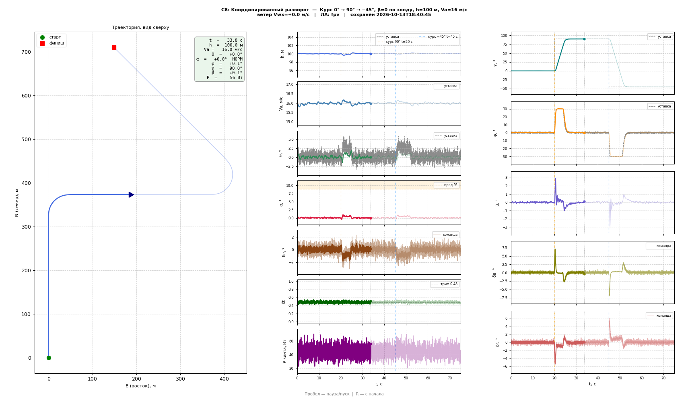

| Обозначение | Что значит |
|---|---|
| чёрный пунктир | уставка — что требовалось от САУ |
| тонкая линия цвета канала | команда руля до привода (сам руль чуть отстаёт) |
| вертикальные линии | события: команды, точки маршрута, касания |
| оранжевая и красная зоны на `α` | предупреждение и критический угол атаки |
| цвет рамки справки | индикатор угла атаки в текущий момент |

Пробел — пауза, `R` — с начала.

### 3D-повтор

```bash
python viz/viewer3d.py                                # последний полёт
python viz/viewer3d.py <файл> --map kainki_osm --cam 4 --at 20 --speed 2
```

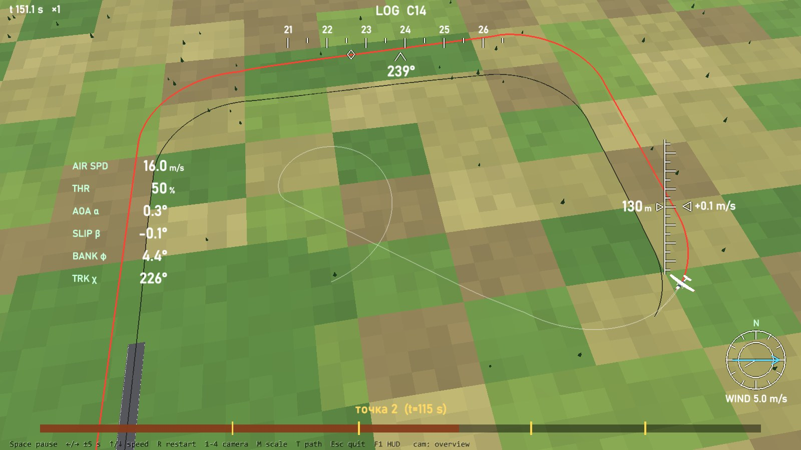

| Клавиша | Действие |
|---|---|
| Пробел | пауза |
| `←` / `→` | назад / вперёд на 5 с |
| `↑` / `↓` | быстрее / медленнее в 2 раза |
| `R` | в начало |
| `1`–`4` | камера |
| `T` | показать весь путь |
| щелчок по полосе времени | перейти к моменту (жёлтые метки — события) |

`--shot файл.png` — сохранить снимок экрана и выйти (для отчётов).

### Свои расчёты по записи

`.flightlog` — архив numpy: каналы-массивы и описание полёта.

```python
from flight_logger import load_log
d = load_log("results/<файл>.flightlog")
d["t"], d["h"], d["Va"], d["alpha_true"]     # время, высота, скорость, угол атаки (рад)
d["meta"]["scenario"], d["meta"]["events"]   # описание и события
```

Список каналов: `python flight_logger.py <файл> --stats`.

---

## 10. Свой сценарий

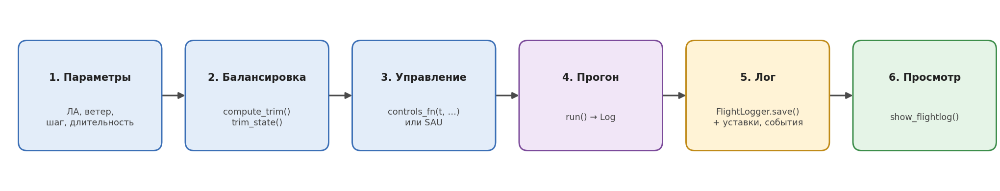

Сценарий — обычный скрипт Python. Ниже — полный рабочий пример: команда тангажа +5°
при встречном ветре. Сохраните его в `scenarios/` и запустите.

```python
import os, sys
sys.path.insert(0, os.path.join(os.path.dirname(__file__), ".."))

import numpy as np
from sim.config import AircraftParams, WindParams, SimConfig, SensorParams
from sim.state import THETA, Q, H
from runner import run, compute_trim, trim_state, print_summary
from control.controllers import PitchController, PitchControlParams, with_roll_hold
from flight_logger import FlightLogger
from viz.viewer import show_flightlog

# 1. Параметры: аппарат, ветер, шаг и длительность
aircraft = AircraftParams()                          # FPV-самолёт по умолчанию
wind     = WindParams(Vw_const=-3.0)                 # встречный ветер 3 м/с
cfg      = SimConfig(Va0=16.0, h0=100.0, dt=0.01, t_end=30.0)

# 2. Балансировка: горизонтальный полёт на скорости Va0
alpha_trim, de_trim, thr_trim = compute_trim(aircraft, cfg.Va0)
s0 = trim_state(aircraft, cfg)

# 3. Управление: регулятор тангажа, уставка +5° с 5-й секунды
pitch = PitchController(aircraft, PitchControlParams(Va_ref=cfg.Va0))
pitch.set_trim_throttle(thr_trim)
pitch.set_trim_elevator(de_trim)
theta_ref_log = []

def controls_fn(t, state, Va, alpha):
    theta_ref = alpha_trim if t < 5.0 else np.radians(5.0)
    theta_ref_log.append(theta_ref)
    pitch.set_pitch_setpoint(theta_ref)
    meas = {"theta": state[THETA], "q": state[Q], "h": state[H], "Va": Va}  # без шума
    return pitch.step(t, meas, cfg.dt)               # [δe, δt]

# 4. Прогон; крен держит RollHold (момент винта иначе кренит самолёт)
log = run(with_roll_hold(controls_fn, aircraft, SensorParams(), cfg.dt),
          aircraft, wind, cfg, state0=s0)
print_summary(log, aircraft, label="Мой сценарий")

# 5. Запись: уставки и события попадут на графики
path = FlightLogger(scenario="Мой сценарий", description="θ = +5° при встречном ветре",
                    aircraft=aircraft, wind_params=wind, cfg=cfg,
                    trim=(alpha_trim, de_trim, thr_trim),
                    events=[{"t": 5.0, "label": "θ = +5°", "color": "steelblue"}],
                    ).save(log, theta_ref=theta_ref_log)

# 6. Просмотр
show_flightlog(path)
```

**Что важно знать**

- `controls_fn(t, state, Va, alpha)` вызывается на каждом шаге (по умолчанию 0.01 с) и
  возвращает `[δe, δt]` или `[δe, δt, δa, δr]` — рули в радианах, газ от 0 до 1. Внутри
  шага интегрирования управление не меняется — как в цифровом автопилоте.
- Компоненты состояния берутся по именам: `state[THETA]`, `state[H]` и т. п.
  (`sim/state.py`): скорости `U`, `V`, `W`; угловые скорости `P`, `Q`, `R`; углы `PHI`,
  `THETA`, `PSI`; координаты `X` (север), `Y` (восток), `H` (высота).
- **Ветер** — `WindParams`: постоянный (`Vw_const` — на север, `Vw_cross` — на восток),
  порыв (`gust_amp`, `gust_t0`, `gust_dur`), сдвиг ветра по высоте (`dV_shear` между
  `h_shear_lo` и `h_shear_hi`).
- **Шум датчиков** — функции `control/sensors.py` с параметрами `SensorParams`
  ([SENSORS.md](SENSORS.md)).
- **Полная САУ** (высота, скорость, курс, маршрут) — как в `scenarios/s10_waypoints.py`:
  класс `FullSAU` из `scenarios/lateral_common.py`.
- Уставки (`h_ref`, `theta_ref`, `Va_ref`, `chi_ref`, `phi_ref`) и точки маршрута
  (`waypoints`), переданные в `save()`, появятся на графиках пунктиром.

---

## 11. Свой летательный аппарат

Все параметры аппарата — в одном классе `AircraftParams` (`sim/config.py`); код модели и
САУ от них не зависит.

| Группа | Параметры |
|---|---|
| Масса и инерция | `mass`, `Jx`, `Jy`, `Jz`, `Jxz` |
| Геометрия | площадь крыла `S`, размах `b`, хорда `c` |
| Продольная аэродинамика | `CL0`, `CLa`, `CLq`, `CLde`; `CDp`, `e_oswald`; `Cm0`, `Cma`, `Cmq`, `Cmde`; срыв: `alpha_stall`, `M_sigmoid` |
| Боковая аэродинамика | `CY_*`, `Croll_*`, `Cn_*` (по β, p, r, δa, δr) |
| Мотор и винт | диаметр `D_prop`, коэффициенты тяги и момента винта `C_T*`, `C_Q*`; `KV_rpm`, `R_motor`, `i0`, напряжение `V_max` |
| Рули и газ | упоры `delta_e_max`, `delta_e_min`, `delta_a_max`, `delta_r_max`; пределы газа; приводы — постоянная времени `servo_tau`, предельная скорость `servo_rate` |
| Шасси | колёса `gear_wheels` и точки конструкции `gear_hard`, жёсткость `gear_k`, демпфирование `gear_c`, трение `gear_mu_*`, `gear_v_crash` |
| Пороги индикации | `alpha_warning`, `alpha_crit` |

**Как добавить аппарат**

1. Напишите функцию, возвращающую `AircraftParams` с вашими числами и своим `name`
   (пример — `aerosonde_params()` в том же файле).
2. Зарегистрируйте её в `AIRCRAFT_TYPES` (`sim/config.py`) — тогда аппарат можно выбрать
   флагом `--aircraft имя` в тренажёре, стенде и конструкторе.
3. 3D-модель: если для `name` нет своей в `viz/aircraft3d.MODELS`, рисуется модель по
   умолчанию, растянутая до вашего размаха.
4. **Пересчитайте САУ.** Коэффициенты регуляторов рассчитываются по модели аппарата:

   ```python
   from control.tuning import design_sau, print_design
   d = design_sau(my_aircraft, Va=18.0)      # Va — крейсерская скорость вашего аппарата
   print_design(d)                           # таблица: коэффициенты и ожидаемые переходные процессы
   ```

   Затем запустите `python checks/check_sau.py` — проверка ступеньками на полной модели.
5. Для оценки аэродинамических производных по геометрии есть пример расчёта —
   `checks/estimate_fpv_aero.py` (так получены числа FPV-самолёта).

---

## 12. Ограничения и частые вопросы

**Чего модель не умеет**

- Момент тангажа и боковые силы после срыва не моделируются: сваливание показывает
  потерю подъёмной силы и рост сопротивления, но не штопор.
- Нет турбулентности — только постоянный ветер, порыв и сдвиг.
- Датчики без дрейфа и задержек, GPS обновляется на каждом шаге; фильтра (оценки
  состояния) в САУ нет.
- В тренажёре и стенде датчики идеальные (без шума); шум есть в сценариях.
- Здания и деревья в 3D не твёрдые.

**Почему САУ хуже работает на скорости 25 м/с, чем на 16?**
Коэффициенты рассчитаны на крейсер 16 м/с. Эффективность рулей растёт с квадратом
скорости; руль высоты и элероны это учитывают, остальные контуры — нет. Для другого
режима пересчитайте САУ (`design_sau`, [раздел 11](#11-свой-летательный-аппарат)).

**Почему самолёт сам кренится, если ничего не нажимать?**
Винт создаёт реактивный момент по крену, а спиральное движение у этого аппарата
неустойчиво — как у многих настоящих самолётов. Парируйте элеронами или включите САУ.

**Где лежат записи и как их удалить?**
В `results/`. Папка не попадает в git, её можно чистить целиком.

**Окно станции или схемы не открылось.**
Они запускаются отдельными процессами. Если окно закрыть, 3D продолжит работать;
перезапустите программу, чтобы вернуть окно.

**Где подробнее про модель и САУ?**
[physics.md](physics.md) — уравнения движения; [aerodynamics.md](aerodynamics.md) —
аэродинамика; [control.md](control.md) — САУ; [architecture.md](architecture.md) —
устройство кода.
