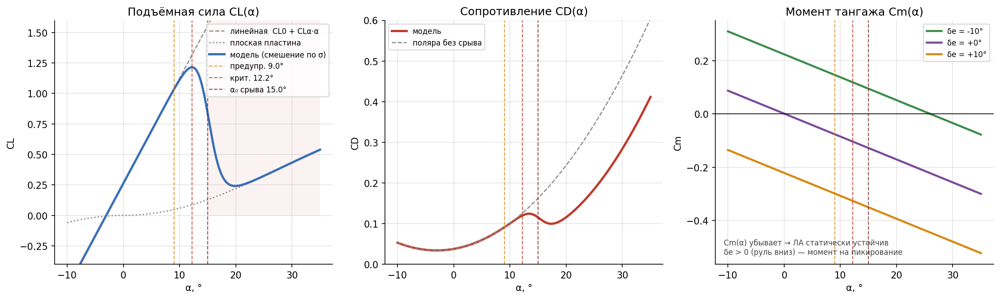
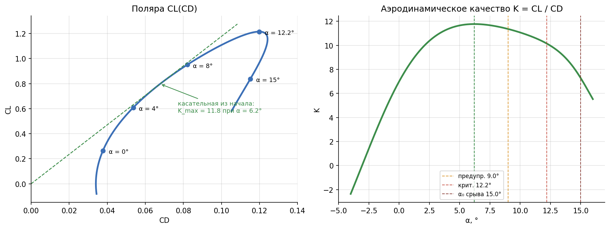
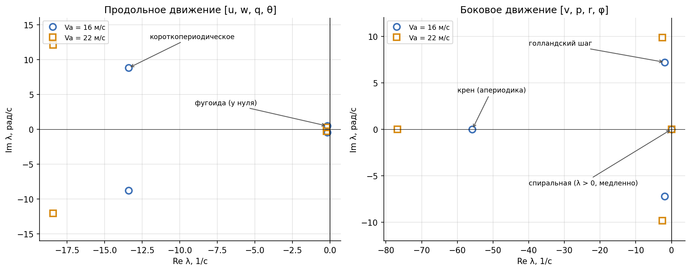

# Аэродинамика

Справочник по аэродинамической модели: какой самолёт моделируется, как считаются
коэффициенты сил и моментов, откуда взяты числа, какие у самолёта собственные движения.
Как силы входят в уравнения движения — в [physics.md](physics.md).

Модель — B&M 2-е изд., гл. 4 (линейные производные + нелинейный срыв по подъёмной силе)
с поправками проекта. Реализация — `sim/aero.py`, параметры — `AircraftParams` в
`sim/config.py`.

---

## 1. Моделируемый самолёт

По умолчанию — FPV-самолёт классической схемы класса 1.8 м, по типу Volantex Ranger 2000
или Skywalker 1900: высокоплан, тянущий винт в носу, нормальное оперение с рулём высоты и
рулём направления, элероны.

| Параметр | Значение |
|---|---|
| масса | 2.0 кг |
| крыло | 1.8 × 0.25 м, S = 0.45 м², удлинение 7.2, поперечное V 3°, профиль типа Clark-Y |
| горизонтальное оперение | 0.08 м², плечо 0.75 м, руль высоты 40 % хорды |
| вертикальное оперение | 0.04 м², плечо 0.75 м, руль направления 40 % хорды |
| элероны | 50–95 % полуразмаха, 25 % хорды |
| фюзеляж | 1.2 × 0.1 м |
| запас продольной устойчивости | 10 % средней хорды |
| моменты инерции | Jx = 0.101, Jy = 0.104, Jz = 0.171 кг·м², Jxz = 0 |

> **Это оценка.** Геометрия и масса — типичные для класса, не замеры конкретного
> аппарата. Производные посчитаны по геометрии учебными инженерными формулами (Nelson,
> Raymer, Roskam) в `checks/estimate_fpv_aero.py`: скрипт печатает каждый
> промежуточный результат и сверяет итог с `sim/config.py`. Погрешность таких оценок —
> десятки процентов; все числа заменяются продувкой или лётной идентификацией.

Силовая установка — по паспортным и продувочным данным (мотор T-Motor AT2814 900KV,
винт APC 11×7E, батарея 4S), см. [physics.md, раздел 4.3](physics.md#43-мотор-и-винт).

Прежний самолёт проекта — Aerosonde из B&M (11 кг, размах 2.9 м) — остался пресетом
`aerosonde_params()` (раздел 7).

---

## 2. Продольные коэффициенты

### 2.1 Подъёмная сила

До срыва подъёмная сила растёт линейно с углом атаки. После срыва крыло обтекается как
плоская пластина. Переход между двумя режимами — гладкая функция σ(α):

$$
\sigma(\alpha) = \frac{1 + e^{-M(\alpha - \alpha_0)} + e^{M(\alpha + \alpha_0)}}
{\big(1 + e^{-M(\alpha - \alpha_0)}\big)\big(1 + e^{M(\alpha + \alpha_0)}\big)}
$$

$$
C_L = (1 - \sigma)\,(C_{L0} + C_{L\alpha}\alpha) + \sigma\cdot 2\,\mathrm{sign}(\alpha)\sin^2\alpha\cos\alpha
+ C_{Lq}\frac{c\,q}{2V_a} + C_{L\delta_e}\delta_e
$$

σ ≈ 0 до срыва и ≈ 1 после него; $\alpha_0$ — центр перехода, $M = 50$ — его крутизна.
Члены с угловой скоростью тангажа $q$ и рулём высоты — линейные добавки.

### 2.2 Сопротивление

До срыва — параболическая поляра (вредное + индуктивное сопротивление), после — плоская
пластина, смешение по тому же σ:

$$
C_D = (1 - \sigma)\Big(C_{Dp} + \frac{(C_{L0} + C_{L\alpha}\alpha)^2}{\pi e A}\Big)
+ \sigma\,\big(C_{Dp} + 2|\sin\alpha|^3\big) + C_{Dq}\frac{c\,q}{2V_a} + C_{D\delta_e}|\delta_e|
$$

$A = b^2/S$ — удлинение, $e$ — коэффициент Освальда.

**Поправки проекта к B&M** (РЕШ-19): в учебнике поляра не знает о срыве — здесь она
смешивается с плоской пластиной по σ, согласованно с $C_L$; член руля высоты взят по
модулю $|\delta_e|$ — иначе отклонение руля в одну сторону уменьшало бы сопротивление.

### 2.3 Момент тангажа

$$
C_m = C_{m0} + C_{m\alpha}\alpha + C_{mq}\frac{c\,q}{2V_a} + C_{m\delta_e}\delta_e
$$

- $C_{m\alpha} < 0$ — **статическая устойчивость**: при росте угла атаки возникает
  пикирующий момент, самолёт сам возвращается к балансировочному углу.
- $C_{mq} < 0$ — **демпфирование**: гасит колебания по тангажу.
- $C_{m\delta_e} < 0$: руль высоты вниз ($\delta_e > 0$) опускает нос. Команда «нос
  вверх» — $\delta_e < 0$.

Срыв в моменте тангажа не моделируется: надёжных данных нет.

### 2.4 Параметры FPV-самолёта

| Коэффициент | Значение | Как получено |
|---|---|---|
| $C_{L0}$ | 0.264 | установка крыла 0°, угол нулевой подъёмной силы профиля −3.5° |
| $C_{L\alpha}$ | 4.94 1/рад | формула Гельмбольда для крыла (4.60) + оперение с учётом скоса потока |
| $C_{Lq}$, $C_{mq}$ | 3.41; −11.3 | вклад оперения (+10 % на фюзеляж для $C_{mq}$) |
| $C_{L\delta_e}$, $C_{m\delta_e}$ | 0.426; −1.28 | эффективность руля высоты 0.75 (тонкий профиль — верхняя оценка) |
| $C_{m0}$ | 0.0014 | установка оперения −0.3° — балансировка на 16 м/с при δe = 0 |
| $C_{m\alpha}$ | −0.494 1/рад | запас устойчивости 10 %: $C_{m\alpha} = -0.1\,C_{L\alpha}$ |
| $C_{Dp}$, $e$ | 0.034; 0.833 | эквивалентное трение по смоченной поверхности; $e$ по Raymer |
| $C_{Dq}$, $C_{D\delta_e}$ | 0; 0 | не оценивались |
| $\alpha_0$ (центр срыва) | 15° | максимум $C_L$ профиля 1.35 × 0.9 = 1.215 |

### 2.5 Значения по углу атаки

Без отклонения рулей и вращения ($q = 0$, $\delta_e = 0$):

| α, ° | σ | CL | CD | Cm | K = CL/CD | |
|---|---|---|---|---|---|---|
| −4 | 0.00 | −0.08 | 0.034 | +0.036 | — | |
| 0 | 0.00 | 0.26 | 0.038 | +0.001 | 7.0 | крейсер 16 м/с |
| 4 | 0.00 | 0.61 | 0.054 | −0.033 | 11.3 | |
| 6 | 0.00 | 0.78 | 0.066 | −0.050 | 11.8 | наибольшее качество |
| 8 | 0.00 | 0.95 | 0.082 | −0.067 | 11.6 | |
| 9 | 0.01 | 1.03 | 0.091 | −0.076 | 11.4 | **предупреждение** |
| 12.2 | 0.08 | **1.215** | 0.120 | −0.104 | 10.1 | **критический: максимум CL** |
| 15 | 0.50 | 0.84 | 0.115 | −0.128 | 7.3 | центр срыва α₀ |
| 18 | 0.93 | 0.29 | 0.101 | −0.154 | 2.9 | |
| 30 | 1.00 | 0.43 | 0.284 | −0.257 | 1.5 | плоская пластина |
| 90 | 1.00 | 0.00 | 2.034 | −0.774 | 0 | |

Пороги индикации угла атаки (НОРМ / ПРЕД / КРИТ / СРЫВ) — `alpha_warning` = 9°,
`alpha_crit` = 12.2° (максимум $C_L$), срыв — α₀ = 15°. Скорость сваливания по
$C_{L,max}$ = 1.215 — 7.5 м/с.

### 2.6 Поляра и качество

Наибольшее аэродинамическое качество K = 11.8 — при α ≈ 6°; касательная из начала
координат к поляре касается её в этой точке. На крейсере (α ≈ 0°) качество 7: крейсер
выбран быстрее наивыгоднейшей скорости (подробнее — [physics.md, раздел 7](physics.md#7-балансировка)).

---

## 3. Боковые коэффициенты

Линейная модель по скольжению β, безразмерным угловым скоростям
$\hat p = \dfrac{b\,p}{2V_a}$, $\hat r = \dfrac{b\,r}{2V_a}$ и рулям (B&M ур. 4.14–4.15):

$$
\begin{aligned}
C_Y &= C_{Y\beta}\beta + C_{Yp}\hat p + C_{Yr}\hat r + C_{Y\delta_a}\delta_a + C_{Y\delta_r}\delta_r \\
C_{roll} &= C_{roll,\beta}\beta + C_{roll,p}\hat p + C_{roll,r}\hat r + C_{roll,\delta_a}\delta_a + C_{roll,\delta_r}\delta_r \\
C_n &= C_{n\beta}\beta + C_{np}\hat p + C_{nr}\hat r + C_{n\delta_a}\delta_a + C_{n\delta_r}\delta_r
\end{aligned}
$$

Свободные члены равны нулю — самолёт симметричен. Реализация — `aero.aero_lateral()`.

| | β | p̂ | r̂ | δa | δr |
|---|---|---|---|---|---|
| $C_Y$ (боковая сила) | −0.187 | 0.021 | 0.156 | 0 | 0.140 |
| $C_{roll}$ (момент крена) | −0.071 | −0.766 | 0.101 | 0.457 | 0.0078 |
| $C_n$ (момент рыскания) | 0.067 | −0.035 | −0.074 | −0.038 | −0.058 |

Смысл главных производных:

| Производная | Знак | Что означает |
|---|---|---|
| $C_{roll,\beta}$ | < 0 | поперечная устойчивость: при скольжении самолёт кренится от потока (эффект поперечного V) |
| $C_{roll,p}$ | < 0 | демпфирование крена |
| $C_{n\beta}$ | > 0 | путевая (флюгерная) устойчивость: нос разворачивается навстречу потоку |
| $C_{nr}$ | < 0 | демпфирование рыскания |
| $C_{roll,\delta_a}$ | > 0 | эффективность элеронов: δa > 0 — крен вправо |
| $C_{n\delta_a}$ | < 0 | обратное рыскание элеронов: при крене вправо нос уходит влево |
| $C_{n\delta_r}$ | < 0 | эффективность руля направления: δr > 0 — нос влево |

Как получены (`checks/estimate_fpv_aero.py`): боковые производные по скольжению — киль,
фюзеляж и поперечное V крыла; демпфирование крена и эффективность элеронов — полосовая
теория; $C_{roll,r}$, $C_{np}$, $C_{n\delta_a}$ зависят от подъёмной силы и взяты на
крейсере.

---

## 4. Собственные движения

Если линеаризовать модель около балансировки, малые отклонения раскладываются на
независимые «моды» — собственные движения. Их корни (собственные значения) показывают,
насколько быстро и с каким затуханием самолёт сам реагирует на возмущения, — от этого
отталкивается расчёт САУ.

| Движение | Что это | Va = 16 м/с | Va = 22 м/с |
|---|---|---|---|
| короткопериодическое | быстрые колебания угла атаки и тангажа | ωn = 16.0 рад/с, ζ = 0.84 | ωn = 22.0 рад/с, ζ = 0.84 |
| фугоида | медленный обмен высоты на скорость | период 13.4 с, ζ = 0.37 | период 22.5 с, ζ = 0.65 |
| крен | апериодическое затухание скорости крена | τ = 0.018 с | τ = 0.013 с |
| голландский шаг | колебания рыскания и крена | ωn = 7.4 рад/с, ζ = 0.25 | ωn = 10.2 рад/с, ζ = 0.25 |
| спиральное | медленный уход в крен и разворот | неустойчиво, удвоение за 39 с | почти нейтрально (удвоение за 450 с) |

Короткопериодическое движение хорошо задемпфировано — самолёт «послушен» по тангажу.
Голландский шаг задемпфирован слабо (ζ = 0.25), спиральное движение медленно
неустойчиво — как у многих лёгких самолётов: без управления самолёт за десятки секунд
сваливается в разворот. С этим справляется контур крена САУ.

Значения считает `docs/figures/model_plots.py`; численная линеаризация по полной модели,
боковой баланс — с элеронами и рулём направления против реактивного момента винта.
Проверки — `checks/check.py` (раздел 7) и `checks/check_lateral.py`.

---

## 5. Как коэффициенты превращаются в силы

$$
L = \bar q S C_L,\quad D = \bar q S C_D,\quad M = \bar q S c\,C_m,\quad
Y = \bar q S C_Y,\quad L_{roll} = \bar q S b\,C_{roll},\quad N = \bar q S b\,C_n,
\qquad \bar q = \tfrac12\rho V_a^2
$$

Подъёмная сила и сопротивление поворачиваются в связанную систему на угол атаки
([physics.md, раздел 4.2](physics.md#42-аэродинамика)). Безразмерные угловые скорости
защищены от деления на ноль при $V_a < 1$ м/с.

---

## 6. Своя аэродинамика

**Вариант А — свои коэффициенты.** Заменить числа в своём наборе `AircraftParams`
([USER_GUIDE.md, раздел 11](USER_GUIDE.md#11-свой-летательный-аппарат)). Модель и САУ
не меняются; коэффициенты САУ пересчитываются `design_sau()`.

**Вариант Б — таблицы продувки.** Если есть $C_L(\alpha)$, $C_D(\alpha)$, $C_m(\alpha)$
таблицами, замените в `sim/aero.py` функции `coef_CL`, `coef_CD`, `coef_Cm` на
интерполяцию по таблице (`numpy.interp`) с теми же аргументами. Остальной код
использует только эти функции.

---

## 7. Пресет Aerosonde

`aerosonde_params()` — набор B&M 2-е изд. (файл авторов
`mavsim_python/parameters/aerosonde_parameters.py`) с поправками проекта:

| Параметр | Aerosonde | FPV |
|---|---|---|
| масса, размах, площадь крыла | 11 кг, 2.90 м, 0.55 м² | 2 кг, 1.80 м, 0.45 м² |
| $C_{L\alpha}$, $C_{m\alpha}$ | 5.61; −2.74 | 4.94; −0.49 |
| $C_{L\delta_e}$, $C_{m\delta_e}$ | 0.13; −0.99 | 0.43; −1.28 |
| $C_{Dp}$, $e$ | 0.043; 0.9 | 0.034; 0.83 |
| α₀ срыва | 16° | 15° |
| винт, мотор, батарея | 20″, 145KV, 12S | 11″, 900KV, 4S |

Поправки к набору B&M (РЕШ-19): центр срыва α₀ уменьшен с 27° до 16° (в учебнике
$C_{L,max}$ = 2.4 — нереально для крыла малого БПЛА), сопротивление после срыва —
плоская пластина, $|\delta_e|$ в сопротивлении, свободное вращение винта. Знак
$C_{Y\delta_r}$ = +0.19 — по 2-му изданию (в 1-м была ошибка знака, РЕШ-15).

Выбрать Aerosonde можно, зарегистрировав его в `AIRCRAFT_TYPES` и запустив программу с
`--aircraft`. Коэффициенты САУ по умолчанию рассчитаны для FPV — для Aerosonde их нужно
пересчитать (`design_sau`).
