# Система автоматического управления (САУ)

Справочник по САУ симулятора: из каких контуров она состоит, как каждый контур устроен,
откуда берутся его коэффициенты и как он ведёт себя на полной модели. Модель самолёта —
в [physics.md](physics.md) и [aerodynamics.md](aerodynamics.md), датчики — в
[SENSORS.md](SENSORS.md).

Все числа ниже — для FPV-самолёта по умолчанию (`AircraftParams()`) на крейсерской
скорости 16 м/с. Это результаты **моделирования**, а не эксперимента: графики посчитаны на
полной нелинейной модели 6DOF с приводами рулей скриптом
[`docs/figures/sau_plots.py`](figures/sau_plots.py), схемы нарисованы
[`docs/figures/sau_diagrams.py`](figures/sau_diagrams.py). После изменения кода их можно
перерисовать — числа в таблицах печатает тот же скрипт.

**Содержание**

1. [Обзор](#1-обзор)
2. [Как рассчитаны коэффициенты](#2-как-рассчитаны-коэффициенты)
3. [Тангаж](#3-тангаж)
4. [Высота и скорость: TECS и раздельные контуры](#4-высота-и-скорость-tecs-и-раздельные-контуры)
5. [Крен](#5-крен)
6. [Курс и скольжение](#6-курс-и-скольжение)
7. [Защита по углу атаки](#7-защита-по-углу-атаки)
8. [Навигация по точкам](#8-навигация-по-точкам)
9. [САУ одним классом — `SAU`](#9-сау-одним-классом--sau)
10. [LQR](#10-lqr)
11. [Проверки](#11-проверки)
12. [Ограничения и что дальше](#12-ограничения-и-что-дальше)

---

## 1. Обзор

### 1.1 Структура

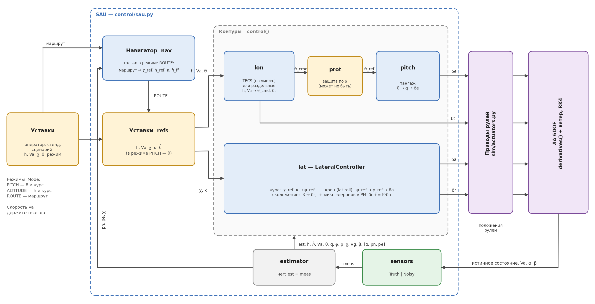

САУ — один класс `control.sau.SAU` (раздел 9). На каждом шаге интегрирования (100 Гц)
он делает одно и то же:

1. **Датчики** (`sensors`) превращают истинное состояние в измерения — с шумом
   (`NoisySensors`, сценарии) или без (`TruthSensors`, тренажёр и стенд).
2. **Оценка состояния** (`estimator`) — пока её нет: САУ работает прямо по измерениям.
3. **Наведение** (`nav`) — в режиме маршрута навигатор выдаёт уставки курса и высоты.
4. **Продольный внешний контур** (`lon`) по уставкам высоты и скорости даёт команду
   тангажа θ_cmd и газ δt. По умолчанию это TECS (раздел 4).
5. **Защита по углу атаки** (`prot`) может заменить θ_cmd и газ, если α подходит к
   критическому (раздел 7).
6. **Тангаж** (`pitch`) отрабатывает θ_ref рулём высоты δe (раздел 3).
7. **Боковой канал** (`lat`): курс → уставка крена → элероны δa; скольжение → руль
   направления δr (разделы 5–6).

Команды `[δe, δt, δa, δr]` идут в приводы рулей (`sim/actuators.py`: апериодическое
звено, ограничение скорости, упоры — [physics.md, раздел 6](physics.md#6-приводы-рулей)).
Привод — часть объекта управления, а не САУ. Управление на шаге интегрирования не
меняется (дискретная САУ).

### 1.2 Контуры

| Контур | Вход → выход | Класс (файл) | Раздел |
|---|---|---|---|
| Тангаж | θ_ref → q_ref → δe | `PitchController` (controllers.py) | 3 |
| Высота и скорость — по умолчанию | h_ref, Va_ref → θ_cmd, δt через энергию | `TECS` (tecs.py) | 4.1 |
| Высота и скорость — раздельно | h → θ_cmd (ПИ), Va → δt (ПИ) | `AltSpeedHold` = `AltitudeHold` + `SpeedController` | 4.2 |
| Крен | φ_ref → p_ref → δa (упреждение + ПИ по p) | `RollController` (controllers.py) | 5 |
| Курс | χ_ref, κ → φ_ref | `LateralController` (controllers.py) | 6.1 |
| Скольжение | β → δr, + микс δa → δr | `LateralController` | 6.2 |
| Защита по α | α → замена θ_cmd и газа | `AngleOfAttackProtector` (aua.py) | 7 |
| Навигация | маршрут, GPS → χ_ref, h_ref, κ, ḣ_ff | `WaypointNavigator` (navigation.py) | 8 |
| LQR (альтернатива продольному каскаду) | [u, w, q, θ], h → δe, δt | `LQRController` (lqr.py) | 10 |

### 1.3 Режимы

| Режим `Mode` | Что задаёт оператор | Что держит САУ |
|---|---|---|
| `PITCH` | тангаж θ, курс χ, скорость Va | θ и χ; газ держит скорость |
| `ALTITUDE` | высоту h, курс χ, скорость Va | h, χ, Va |
| `ROUTE` | маршрут (точки N, E, h), скорость Va | курс и высоту выдаёт навигатор |

Скорость держится во всех режимах.

### 1.4 Где используется

| Программа | Как подключена САУ |
|---|---|
| 3D-тренажёр `GameScenario3D` | `SAU` с истинными датчиками; режимы и уставки — клавиши, маршрут — окно станции |
| стенд `Bench3D` | подкласс `BenchSAU`: + защита по α и режим «Срыв»; параметры — ползунками на лету |
| конструктор `BlockLab3D` | часть каналов ведёт схема из блоков (`control/blocks.py`), остальные — `SAU` |
| сценарии s8–s10 | `scenarios/lateral_common.FullSAU` — обёртка `SAU` с псевдодатчиками |
| сценарии s1–s6 | регуляторы напрямую: `PitchController`, `SpeedController`, П-контур высоты, крен — `RollHold` |
| сценарий s7 | `LQRController` |

### 1.5 Знаки рулей

Знаки рулей — как в [physics.md, раздел 2](physics.md#2-вектор-состояния-и-управление).
Для САУ важны два:

- **δe > 0 — нос вниз.** Поэтому в контуре тангажа стоит «−Kq»: чтобы поднять нос,
  руль отклоняют в минус.
- **δr > 0 — нос влево.** Чтобы убрать скольжение β > 0 (поток справа), нос доворачивают
  вправо: δr = −K·β.

---

## 2. Как рассчитаны коэффициенты

Коэффициенты САУ **не подбираются вручную** — они рассчитываются по модели самолёта
(`control/tuning.py`, решение РЕШ-21). Умолчания классов регуляторов
(`PitchControlParams`, `TECSParams`, `RollControlParams` и т. д.) — результат этого
расчёта для FPV-самолёта на 16 м/с; `checks/check_sau.py` проверяет, что они совпадают.

### 2.1 Метод: последовательное замыкание контуров

Метод — из учебника Beard & McLain (B&M), гл. 6. Каждый контур рассчитывается по
упрощённой линейной модели как звено второго (реже первого) порядка с заданными
собственной частотой ωn и демпфированием ζ. Внешний контур делается медленнее
внутреннего, чтобы для него внутренний контур выглядел почти идеальным звеном «выход =
уставка». Тогда контуры можно рассчитывать по очереди, изнутри наружу.

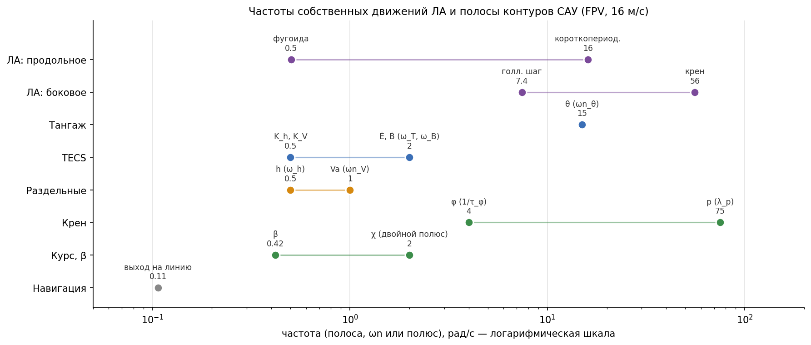

Как разнесены полосы:

- **Продольный канал.** Тангаж (ωn = 15 рад/с) работает на частоте короткопериодического
  движения ЛА (16 рад/с) — он его демпфирует. Темпы энергии TECS (2 рад/с) в 7 раз
  медленнее тангажа, высота и скорость (0.5 1/с) — ещё в 4 раза медленнее.
- **Боковой канал.** Скорость крена (полюс 75 рад/с) чуть быстрее собственного движения
  крена ЛА (56 1/с). Угол крена (4 рад/с) — в 19 раз медленнее. Курс (двойной полюс
  2 рад/с) всего в 2 раза медленнее крена: инерция крена учтена в расчёте курса явно
  (раздел 6.1), поэтому большой разнос не нужен.
- **Навигация** (выход на линию пути, ~0.1 рад/с) — самая медленная.

### 2.2 Упрощённые модели объекта

Модели — линеаризация около горизонтального полёта на скорости Va (B&M гл. 5).
Коэффициенты считает `plant_coeffs(aircraft, Va)`; Γ — комбинации моментов инерции
([physics.md, раздел 3.2](physics.md#32-вращательное-движение)).

| Канал | Модель | Коэффициенты | FPV, 16 м/с |
|---|---|---|---|
| крен | φ̈ = −a_φ1·φ̇ + a_φ2·δa | a_φ1 = −q̄Sb·C_p,p·b/(2Va), a_φ2 = q̄Sb·C_p,δa, где C_p,x = Γ3·Croll_x + Γ4·Cn_x | 56.0 1/с; 593 1/с² |
| скольжение | β̇ = −a_β1·β + a_β2·δr | a_β1 = −ρVaS·CY_β/(2m), a_β2 = ρVaS·CY_δr/(2m) | 0.427; 0.319 |
| тангаж | θ̈ = −a_θ1·θ̇ − a_θ2·θ + a_θ3·δe | a_θ1 = −q̄c·Cmq·c/(2Va·Jy), a_θ2 = −q̄c·Cmα/Jy, a_θ3 = q̄c·Cmδe/Jy | 15.5; 86.7; −224 |
| скорость | V̇a = −a_V1·Va + a_V2·δt | из m·V̇a = T(δt, Va) − D(Va); производные тяги — численно | 0.379 1/с; 11.5 м/с² |
| курс | χ̇ = (g/Vg)·tg φ | координированный разворот | — |
| высота | ḣ = Va·sin γ | — | — |

Здесь q̄ = ½ρVa² — скоростной напор. Модель тяги винта не дифференцируется в явном виде,
поэтому ∂T/∂δt и ∂T/∂Va берутся конечными разностями.

### 2.3 Требования и результат

Требования задаются структурой `SAUSpecs`, результат — `SAUDesign`.

| Контур | Требование (`SAUSpecs`) | Формула | Коэффициенты |
|---|---|---|---|
| скорость крена | полюс λ_p = 75 рад/с | FF = a_φ1/a_φ2, kp_p = (λ_p − a_φ1)/a_φ2, ki_p = kp_p/τ_φ | FF = 0.094 с, kp_p = 0.032 с, ki_p = 0.128 |
| угол крена | τ_φ = 0.25 с, p_max = 120 °/с | p_ref = (φ_ref − φ)/τ_φ | — |
| курс | ζ_χ = 1 | K_χ = 1/(4ζ²τ_φ) | K_χ = 1.0 1/с |
| микс δa → δr | гасить момент рыскания элеронов | K = −N_δa/N_δr, N_x = Γ4·Croll_x + Γ8·Cn_x | −0.654 |
| скольжение | kp_β = 0.5 (шум зонда), ζ_β = 0.7 | ki_β = ((a_β1 + a_β2·kp_β)/(2ζ_β))²/a_β2 | ki_β = 0.55 1/с |
| тангаж | ωn_θ = 15 рад/с, ζ_θ = 0.8 | kp_θ = (ωn² − a_θ2)/a_θ3, kd_θ = (2ζωn − a_θ1)/a_θ3 | Kθ = 16.2 1/с, Kq = 0.038 с |
| TECS: высота, скорость | K_h = K_V = 0.5 1/с | — | — |
| TECS: контуры Ė и Ḃ | ω_T = ω_B = 2 рад/с | K_E = g/a_V2, ki_T = ω_T·K_E, ki_B = ω_B/2 | K_E = 0.852, ki_T = 1.70, ki_B = 1.0 |
| раздельные: высота (ПИ) | ω_h = ωn_θ/30 = 0.5 рад/с, ζ_h = 1.5 | kp_h = 2ζ_h·ω_h/Va, ki_h = ω_h²/Va | 0.094 рад/м, 0.016 рад/(м·с) |
| раздельные: скорость (ПИ) | ωn_V = 1 рад/с, ζ_V = 0.8 | kp_V = (2ζωn − a_V1)/a_V2, ki_V = ωn²/a_V2 | 0.106, 0.087 |
| высота (П, сценарии s5–s6) | ω_h = 0.5 рад/с | KH = ω_h/Va | 0.031 рад/м |

### 2.4 Пересчёт для другого ЛА или другой скорости

```python
from control.tuning import design_sau, SAUSpecs, print_design
from control.sau import SAU, SAUParams

d = design_sau(aircraft, Va=20.0, specs=SAUSpecs(wn_theta=12.0))
print_design(d)                                   # коэффициенты объекта и регуляторов
params = SAUParams(tecs=d.tecs, pitch=d.pitch, lateral=d.lateral,
                   speed=d.speed, altitude=d.altitude)
```

`python -m control.tuning` печатает расчёт для `AircraftParams()` на 16 м/с.

### 2.5 Где полная модель разошлась с учебником

Расчёт проверялся на полной модели (`checks/check_sau.py`, 3D-полёты). Найденные отличия
учтены в `tuning.py`:

- **Коэффициент передачи тангажа.** В модели B&M угол атаки жёстко связан с тангажом
  (α ≡ θ), и замкнутый контур тангажа даёт K = 0.61. В полной модели α возвращается к
  балансировочному, и θ отрабатывает уставку полностью. Для внешних контуров принято K = 1.
- **Предел q_ref каскада тангажа.** При пределе 60 °/с руль высоты ограничивался
  Kq·q_max ≈ 2°, и в полёте 2026-10-07 ЛА «застрял» в наборе на θ = 13.5° — ушёл с 200 на
  500 м. Теперь q_max = Kθ·40°: предел не срабатывает, пока |θ_ref − θ| ≤ 40°.
- **Высота — ПИ, а не П.** На скорости, отличной от точки балансировки, П-контур имеет
  статическую ошибку. ζ_h = 1.5: при 0.9 нуль ПИ давал перерегулирование 18 %.
- **Крен и курс** — до 2026-10-08 были ПИД крена и ПИ курса: ступенька курса 10° давала
  элероны почти в упор и перерегулирование 38 %. Заменены каскадом по схеме PX4
  (разделы 5–6, РЕШ-22).
- **Предел интеграла скорости** = 1/ki — весь диапазон газа (при 0.5 оставалась ошибка
  0.13 м/с).

---

## 3. Тангаж

### 3.1 Структура

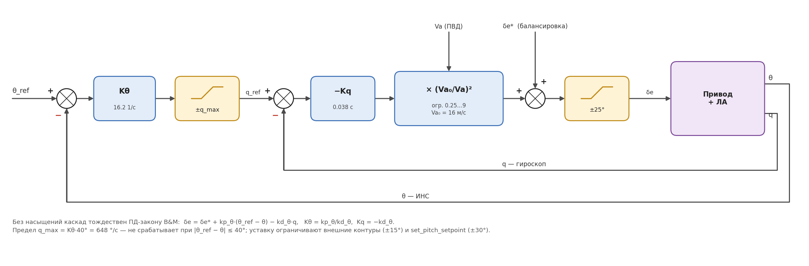

Класс `PitchController`. Каскад из двух П-звеньев:

$$
q_{ref} = K_\theta\,(\theta_{ref} - \theta), \quad |q_{ref}| \le q_{max};
\qquad
\delta_e = \delta_e^* - s_e\,K_q\,(q_{ref} - q), \quad s_e = \left(\frac{V_{a0}}{V_a}\right)^2
$$

- **θ** — от ИНС, **q** — от гироскопа, **Va** — от ПВД.
- **δe\*** — балансировочное отклонение руля (`set_trim_elevator`): регулятор работает с
  отклонением от балансировки, как в линейной модели, и не «проседает» на старте.
- **Масштаб по скорости** `gain_scheduling`: эффективность руля растёт как Va², поэтому
  выход контура умножается на (Va₀/Va)², Va₀ = 16 м/с, в пределах 0.25…9.
- **Знак.** δe > 0 опускает нос, поэтому перед Kq стоит минус.

Без насыщений каскад тождествен ПД-закону B&M δe = δe\* + kp_θ·(θ_ref − θ) − kd_θ·q с
Kθ = kp_θ/kd_θ, Kq = −kd_θ. Каскад удобнее: в нём есть сигнал q_ref, который можно
ограничить и показать на стенде.

**Ограничения:** уставка θ_ref — ±30° (`set_pitch_setpoint`; TECS и ПИ высоты
ограничивают её ±15°), q_ref — ±648 °/с, δe — упоры ±25°.

### 3.2 Переходный процесс

Ступенька уставки тангажа +3°, полная модель против линейной теории (левый столбец).
В средней и правой колонке — крен и курс (разделы 5–6). Внизу — команда САУ и положение
руля после привода: привод запаздывает на сотые доли секунды.

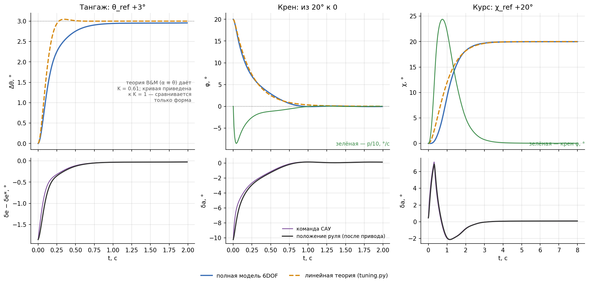

| Ступенька | Перерегулирование, модель / теория | t_уст 5 %, модель / теория |
|---|---|---|
| тангаж θ_ref +3° | 0 / 1.5 % | 0.61 / 0.22 с |

Начальный участок совпадает с теорией, но полная модель подходит к уставке медленнее:
в ней на тангаж влияет изменение угла атаки и скорости, которого в модели B&M нет. Руль
высоты отклоняется не больше чем на 1.9° от балансировки.

---

## 4. Высота и скорость: TECS и раздельные контуры

Продольный внешний контур выбирается полем `SAUParams.lon`: `"tecs"` — по умолчанию
(тренажёр, стенд, s8–s10), `"split"` — раздельные контуры, для сравнения. У обоих один
интерфейс: `step(refs, est, dt, hold_alt) → (θ_cmd, δt)`.

### 4.1 TECS — управление полной энергией

TECS (Total Energy Control System, Lambregts, 1983) управляет высотой и скоростью
**совместно**. Так же устроены продольные контуры автопилотов PX4 (`FW_T_*`) и
ArduPilot (`TECS_*`). Реализация — `control/tecs.py`, РЕШ-27.

**Идея.** Полная механическая энергия ЛА на единицу веса E = h + V²/(2g) складывается
из потенциальной (высота) и кинетической (скорость). TECS работает с её производной по
времени, отнесённой к скорости, — она безразмерна (рад):

$$
\dot E \equiv \frac{1}{V_a}\frac{dE}{dt} = \gamma + \frac{\dot V}{g}, \qquad \gamma = \frac{\dot h}{V_a}
$$

Далее Ė — эта производная полной энергии (в литературе по TECS — specific energy rate).
Её смысл — угол набора, эквивалентный приросту энергии: Ė = 0.05 рад — это набор под
углом 2.9° на постоянной скорости или разгон с ускорением 0.05·g ≈ 0.5 м/с² в горизонте.

Из уравнения движения вдоль траектории m·V̇ = T − D − m·g·sin γ следует

$$
\dot E = \frac{T - D}{m g},
$$

то есть **производная полной энергии зависит только от тяги**: газ добавляет или убирает энергию.
Тангаж энергию не меняет — он **перераспределяет** её между высотой и скоростью. Это
распределение описывает производная баланса энергии

$$
\dot B = w\,\gamma - (2 - w)\,\frac{\dot V}{g} = 2\gamma - (2 - w)\,\dot E,
$$

где вес w ∈ [0, 2] задаёт, что важнее: w = 1 — поровну, w = 0 — тангаж держит только
скорость. Отсюда разделение: **газ ← Ė, тангаж ← Ḃ**.

Раздельные контуры поступают иначе: тангаж держит высоту, газ — скорость. Но тангаж
меняет и скорость (набор за счёт скорости), а газ — и высоту. Поэтому при наборе
скорость проседает, а при снижении растёт; TECS эту связь развязывает.

**Структура.**

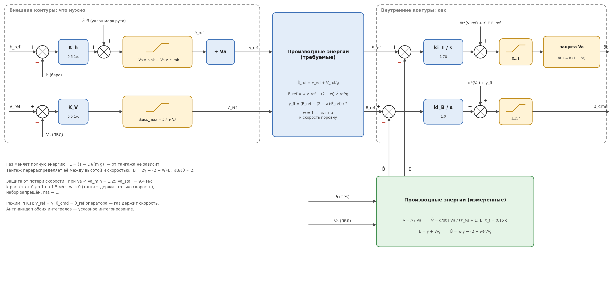

Внешние контуры превращают ошибки высоты и скорости в требуемые производные:

$$
\dot h_{ref} = \dot h_{ff} + K_h\,(h_{ref} - h), \quad
-V_a\gamma_{sink}(V_a) \le \dot h_{ref} \le V_a\gamma_{climb}(V_a), \quad
\gamma_{ref} = \dot h_{ref}/V_a
$$

$$
\dot V_{ref} = K_V\,(V_{ref} - V_a), \quad |\dot V_{ref}| \le a_{max}
$$

$$
\dot E_{ref} = \gamma_{ref} + \dot V_{ref}/g, \qquad
\dot B_{ref} = w\,\gamma_{ref} - (2 - w)\,\dot V_{ref}/g
$$

Внутренние контуры — интегральные (интеграл ошибки по Ė — это ошибка самой энергии) с
упреждением:

$$
\delta_t = \delta_t^*(V_{ref}) + K_E\,\dot E_{ref} + k_{i,T}\!\int(\dot E_{ref} - \dot E)\,dt
$$

$$
\theta_{cmd} = \alpha^*(V_a) + \gamma_{ff} + k_{i,B}\!\int(\dot B_{ref} - \dot B)\,dt,
\qquad \gamma_{ff} = \tfrac{1}{2}\big(\dot B_{ref} + (2 - w)\,\dot E_{ref}\big)
$$

- **δt\*(V), α\*(V)** — балансировка горизонтального полёта, таблица на 10…28 м/с
  (`compute_trim`). Упреждение работает на любой скорости, а не только на 16 м/с.
- **K_E = g/a_V2** — сколько газа нужно на единицу Ė.
- **ḣ_ff** — упреждение от навигатора: уклон участка маршрута × путевая скорость вдоль
  него. Без него на наклонной прямой высота отстаёт на ḣ_ff/K_h.
- **Измерения:** ḣ — вертикальная скорость GPS; V̇ — производная скорости ПВД, пропущенной
  через фильтр первого порядка τ_f = 0.15 с.
- **Пределы угла траектории** γ_climb(V), γ_sink(V) — 0.7 располагаемой производной энергии на
  газе 1 и 0 при этой скорости, но не круче 15°. Поэтому TECS не просит набора, который
  ЛА не может выполнить без потери скорости.
- **Защита от потери скорости.** При Va < Va_min = 1.25·Va_stall = 9.4 м/с коэффициент
  k растёт от 0 до 1 на 1.5 м/с: вес высоты w → 0 (тангаж держит только скорость),
  набор запрещается, газ → 1.
- **Режим PITCH:** γ_ref = γ, θ_cmd = уставка оператора; газ держит скорость.
- **Анти-виндап** обоих интегралов: интеграл не копится, пока выход в упоре.

**Расчёт** (`design_sau → d.tecs`, FPV, 16 м/с):

| Величина | Формула | Значение |
|---|---|---|
| K_h, K_V | требование | 0.5 1/с |
| K_E | g/a_V2 | 0.852 |
| ki_T | ω_T·K_E, ω_T = 2 рад/с | 1.70 |
| ki_B | ω_B/2 (∂Ḃ/∂θ ≈ 2), ω_B = 2 рад/с | 1.0 |
| γ_climb(V) | 0.7·min(Ė_max(V), sin 15°) | 10.4° (на 28 м/с — 8.1°) |
| γ_sink(V) | 0.7·min(−Ė_min(V), sin 15°) | 4.9° на 10 м/с … 10.4° с 19 м/с |
| a_max | 0.7·(T(δt = 1) − D)/m | 5.4 м/с² |

Внутренние контуры — чистые интеграторы. Объект по газу с учётом фильтра —
(a_V2/g)/(τ_f·s + 1), разомкнутый контур ω_T/(s·(τ_f·s + 1)): частота среза ω_T, запас
по фазе 90° − atan(ω_T·τ_f) = 73°. Пропорциональную часть (как `FW_T_THR_DAMP` в PX4) не
берём: шум ПВД 0.2 м/с проходит через дифференцирование V̇ с усилением ω_T·K_E·σ_V/g,
которое от τ_f не зависит (σ газа 0.049 с П-частью против 0.019 без неё). А интеграл V̇ —
это сама отфильтрованная скорость, почти без шума.

### 4.2 Раздельные контуры

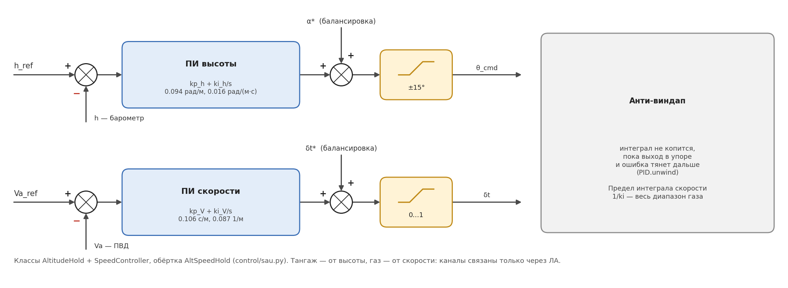

Классический вариант B&M гл. 6 (`AltitudeHold` + `SpeedController`):

$$
\theta_{cmd} = \alpha^* + k_{p,h}(h_{ref} - h) + k_{i,h}\!\int(h_{ref} - h)\,dt, \qquad |\theta_{cmd}| \le 15°
$$

$$
\delta_t = \delta_t^* + k_{p,V}(V_{ref} - V_a) + k_{i,V}\!\int(V_{ref} - V_a)\,dt, \qquad 0 \le \delta_t \le 1
$$

В сценариях s5–s6 вместо ПИ высоты — П-контур θ_ref = α\* + KH·(h_ref − h),
KH = 0.031 рад/м.

### 4.3 Малые ступеньки: проверка расчёта

TECS по каждой из величин ведёт себя как звено первого порядка K/(s + K) (теория —
пунктир). Раздельные контуры — второго порядка с нулём ПИ.

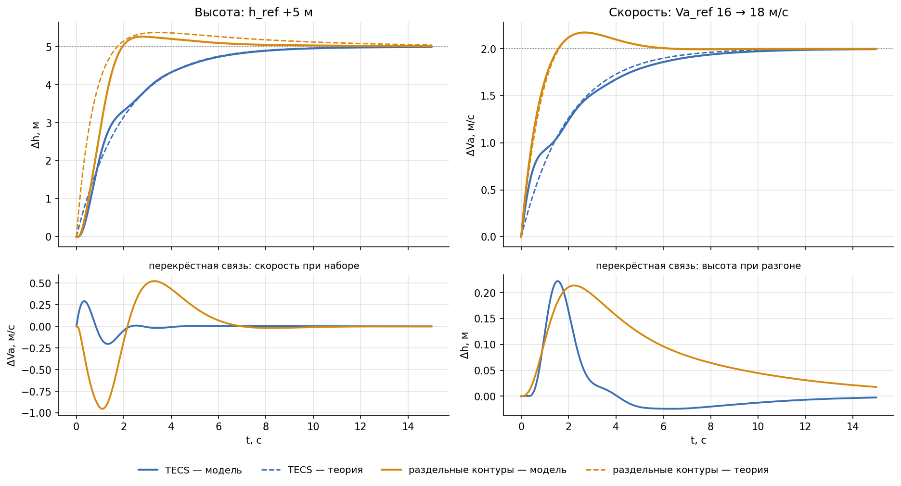

| Контур, ступенька | Перерегулирование, мод. / теор. | t_уст 5 %, мод. / теор. | Влияние на другую величину |
|---|---|---|---|
| TECS, h +5 м | 0 / 0 % | 6.1 / 6.0 с | \|ΔVa\| ≤ 0.29 м/с |
| TECS, Va 16 → 18 м/с | 0 / 0 % | 6.8 / 6.0 с | \|Δh\| ≤ 0.22 м |
| раздельные, h +5 м | 5.4 / 7.6 % | 3.3 / 6.4 с | \|ΔVa\| ≤ 0.95 м/с |
| раздельные, Va 16 → 18 м/с | 8.7 / 8.7 % | 4.0 / 4.0 с | \|Δh\| ≤ 0.21 м |

На малых ступеньках раздельные контуры быстрее (у них выше полоса), но при наборе 5 м
скорость проседает втрое сильнее.

### 4.4 Большие манёвры: TECS против раздельных контуров

Разница видна, когда манёвр упирается в ограничения.

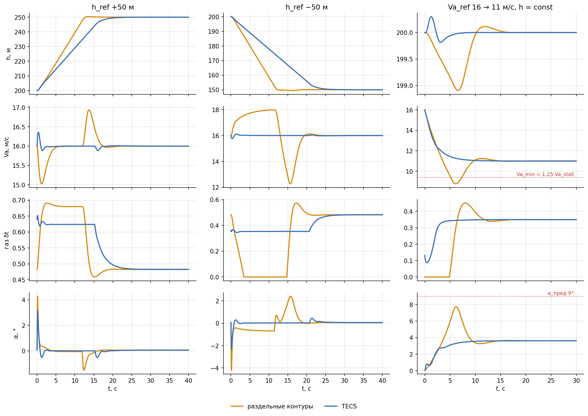

| Манёвр | Контуры | h: t_уст ±1 м | Va в манёвре, м/с | α max | газ в нуле |
|---|---|---|---|---|---|
| h +50 м | раздельные | 12.3 с | 15.0…16.9 | 4.3° | 0 % |
| | **TECS** | 18.8 с | **15.9…16.4** | 3.1° | 0 % |
| h −50 м | раздельные | 11.9 с | 12.3…18.0 | 2.4° | 28 % |
| | **TECS** | 23.6 с | **15.8…16.1** | 0.4° | 0 % |
| Va 16 → 11 м/с, h = const | раздельные | \|Δh\| ≤ 1.1 м | провал до **8.8** | **7.7°** | 16 % |
| | **TECS** | \|Δh\| ≤ 0.3 м | 11.0 (без провала) | 3.6° | 0 % |

- **Раздельные контуры** набирают высоту за счёт скорости и снижаются с разгоном и газом
  в нуле. При торможении до 11 м/с скорость проваливается до 8.8 м/с — ниже Va_min, а угол
  атаки доходит до 7.7° (порог предупреждения — 9°).
- **TECS** меняет высоту не быстрее, чем позволяет располагаемая производная энергии (избыток тяги), поэтому
  скорость почти не меняется. Платой — более медленный набор и снижение.
- **С шумом датчиков** (установившийся полёт): σ газа 0.018 у TECS против 0.021, σ δe 0.25°
  против 0.68°.

### 4.5 TECS на стенде

Вкладка стенда «Высота и скорость (TECS)» показывает схему TECS с живыми значениями на
каждом звене; производные энергии Ė, Ḃ там умножены на Va и выражены в м/с набора (Ė·Va = 1 м/с —
энергии прибавляется столько же, сколько при наборе 1 м/с на постоянной скорости).
Ползунки: K_h, K_V, пределы угла набора и снижения, w, Kp и Ki газа и тангажа (Kp = 0 по
умолчанию — можно включить и увидеть шум газа от ПВД), предел θ, Va_min, τ_f. Режим
«Срыв» на вкладке защиты обходит TECS; при выходе из него интегралы TECS сбрасываются.
Подробно — [USER_GUIDE.md](USER_GUIDE.md).

---

## 5. Крен

### 5.1 Структура

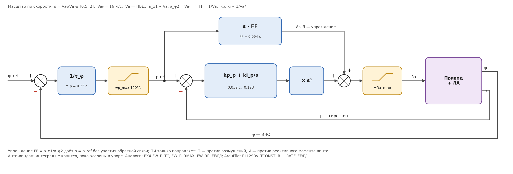

Класс `RollController` (общий для `LateralController` и `RollHold`), схема как в PX4 и
ArduPilot (РЕШ-22):

$$
p_{ref} = \frac{\varphi_{ref} - \varphi}{\tau_\varphi}, \quad |p_{ref}| \le p_{max}
$$

$$
\delta_a = s\cdot FF\cdot p_{ref} + s^2\Big(k_{p,p}\,e_p + k_{i,p}\!\int e_p\,dt\Big), \qquad
e_p = p_{ref} - p, \quad s = \frac{V_{a0}}{V_a} \in [0.5,\,2]
$$

- **Упреждение FF = a_φ1/a_φ2** — отклонение элеронов, при котором установившаяся скорость
  крена равна p_ref. Оно делает основную работу без участия обратной связи.
- **ПИ по скорости крена** только поправляет: П — против возмущений, И — против
  постоянного реактивного момента винта. При p = 0 интеграл копит (φ_ref − φ)/τ_φ, то есть
  снимает и статическую ошибку угла крена.
- **Масштаб s:** a_φ1 ∝ Va, a_φ2 ∝ Va², поэтому FF ∝ 1/Va, kp и ki ∝ 1/Va².
- **Анти-виндап:** интеграл не копится, пока элероны в упоре. Предел интеграла — вклад в
  δa не больше 3.4° (моменту винта нужно ≲ 2°).

Аналоги параметров в автопилотах: τ_φ — PX4 `FW_R_TC` (0.5 с), ArduPilot
`RLL2SRV_TCONST` (0.45 с); p_max — `FW_R_RMAX`, `RLL2SRV_RMAX`; FF, kp, ki —
`FW_RR_FF/P/I`, `RLL_RATE_FF/P/I`. FPV-самолёт резвее типичного, поэтому τ_φ = 0.25 с.

### 5.2 Расчёт

Объект по скорости крена ṗ = −a_φ1·p + a_φ2·δa. С упреждением и П-частью ошибка p
затухает с полюсом a_φ1 + a_φ2·kp_p = λ_p = 75 рад/с (собственный — 56). Нуль ПИ —
на 1/τ_φ. При быстром контуре p угол крена отрабатывает уставку как апериодическое звено
φ/φ_ref ≈ 1/(τ_φ·s + 1).

### 5.3 Переходный процесс

Средний столбец рисунка в разделе 3.2 — выход из крена 20° в горизонт (`RollHold`).
Перерегулирование 0.3 % (теория 0), время установления 0.69 с (теория 0.71 с), элероны
до 10°. Модель и теория практически совпадают.

### 5.4 Крен в продольных сценариях

Реактивный момент винта кренит ЛА, спиральная мода неустойчива: без элеронов ЛА уходит
в спираль за ~25 с. Поэтому в продольных сценариях s1–s7 крен держит `RollHold`
(φ_ref = 0, тот же `RollController`), подключаемый обёрткой
`with_roll_hold(controls_fn, aircraft, sp, dt)`. У него свой генератор шума, чтобы не
сдвигать шум продольных датчиков сценария. |φ| ≲ 0.5°, δa ≈ 0.4°.

---

## 6. Курс и скольжение

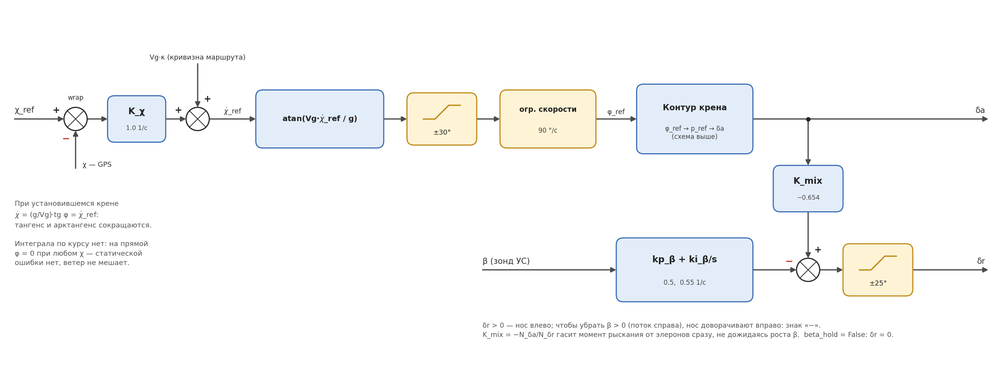

Класс `LateralController`: курс → уставка крена → контур крена (раздел 5) → δa;
скольжение и микс элеронов → δr.

### 6.1 Курс

Держится **путевой угол χ** (направление земной скорости, GPS), а не курс ψ. При боковом
ветре САУ сама выставляет угол упреждения сноса, и линия пути не сносится.

$$
\dot\chi_{ref} = V_g\,\kappa + K_\chi\,\mathrm{wrap}(\chi_{ref} - \chi), \qquad
\varphi_{ref} = \operatorname{arctg}\frac{V_g\,\dot\chi_{ref}}{g}, \quad |\varphi_{ref}| \le 30°
$$

Затем уставка крена проходит **ограничитель скорости** 90 °/с.

- **Почему арктангенс.** В координированном развороте χ̇ = (g/Vg)·tg φ. Если задать
  φ_ref = atan(Vg·χ̇_ref/g), то при установившемся крене тангенс и арктангенс
  сокращаются, и χ̇ = χ̇_ref точно, на любой скорости и при любом крене.
- **wrap** приводит ошибку к [−180°, 180°): разворот идёт кратчайшим путём (с 170° на
  −170° — вправо на 20°, а не влево на 340°).
- **Кривизна κ** заданной траектории приходит от навигатора (1/R на дугах и кружении,
  0 на прямых). Крен atan(Vg²/(g·R)), нужный для дуги радиуса R, задаётся сразу
  упреждением, а не набирается ошибкой курса — как центростремительный член в L1/NPFG.
  Без него на дугах ЛА отставал: в ветре |d − R| был 12.8 м вместо 4.3 м.
- **Интеграла по курсу нет.** На прямой φ = 0 при любом χ, поэтому статической ошибки нет
  даже в ветре (установившаяся ошибка 0.02°).

**Расчёт.** С учётом инерции крена φ/φ_ref ≈ 1/(τ_φ·s + 1) контур курса
χ/χ_ref = K/(τ_φ·s² + s + K), демпфирование ζ = 1/(2√(K·τ_φ)). Для ζ = 1:
K_χ = 1/(4τ_φ) = 1.0 1/с, двойной полюс на 1/(2τ_φ) = 2 рад/с.

**Ступеньки курса** 10°, 30° и 90° (полная САУ, датчики без шума):

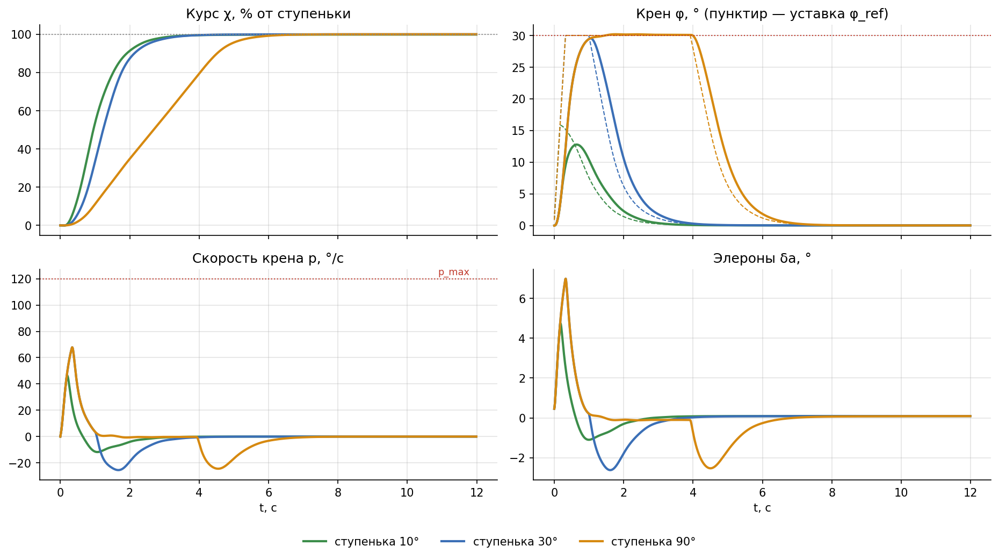

| Условия | Перерегулирование | t_уст 5 %, с | φ max, ° | δa max, ° | p max, °/с | β max, ° |
|---|---|---|---|---|---|---|
| 16 м/с, штиль | 0 / 0 / 0 % | 2.3 / 2.5 / 4.9 | 12.8 / 29.5 / 30.2 | 4.7 / 7.0 / 7.0 | 46 / 68 / 68 | 1.7 / 2.8 / 2.8 |
| 25 м/с, штиль | 0 / 0 / 0 % | 2.3 / 3.1 / 7.2 | 19.8 / 29.9 / 30.0 | 3.9 / 4.4 / 4.4 | 59 / 67 / 67 | 1.2 / 1.3 / 1.3 |
| 12 м/с, штиль | 0 / 0 / 0 % | 2.3 / 2.3 / 3.9 | 9.6 / 26.8 / 30.6 | 5.3 / 9.4 / 9.4 | 38 / 69 / 69 | 2.0 / 4.7 / 4.7 |
| 16 м/с, ветер 5 м/с на восток | 0 / 0 / 0 % | 2.2 / 2.6 / 5.7 | 13.7 / 29.4 / 30.5 | 3.8 / 8.0 / 8.0 | 28 / 61 / 61 | — |

Перерегулирования нет ни на одной скорости. Скорость крена ограничивает не p_max
(120 °/с), а ограничитель скорости уставки крена. Высота при развороте 90° меняется не
больше чем на 0.33 м. В ветре β max не приведено: его определяет не разворот, а порыв в
начале прогона (старт с балансировки без ветра).

Сравнение со ступенькой +20° на линейной теории — правый столбец рисунка в разделе 3.2:
время установления 2.31 с против 2.38 с по теории.

### 6.2 Скольжение

$$
\delta_r = -\Big(k_{p,\beta}\,\beta + k_{i,\beta}\!\int\beta\,dt\Big) + K_{mix}\,\delta_a
$$

β измеряет зонд. kp_β = 0.5 ограничен шумом зонда (σ 0.6°): при kp_β = 2 руль дрожал на
~1.6° за такт. При `beta_hold = False` руль направления в нейтрали, микс тоже выключен.

### 6.3 Координация разворота (РЕШ-23)

После перехода на каскад крена на входе в разворот остался рывок носа против
разворота. Причина — **обратное рыскание элеронов** (Cn_δa < 0): опущенный элерон
сильнее тормозит своё крыло. Уставка крена при ступеньке курса прыгала за один шаг,
упреждение давало δa ≈ 15° скачком, и нос дёргался против разворота (r = −38 °/с).
Контур β отвечает только после роста β и рывок не убирает.

Два средства, оба штатные в автопилотах:

- **Ограничение скорости уставки крена** 90 °/с (PX4 `FW_PN_R_SLEW_MAX`): φ_ref нарастает
  рампой, элероны не скачут. При включении САУ ограничитель стартует с текущего крена.
- **Микс элеронов в руль направления** δr += K_mix·δa (ArduPilot `KFF_RDDRMIX`): момент
  рыскания от элеронов гасится сразу, не дожидаясь β. K_mix = −N_δa/N_δr, где
  N_x = Γ4·Croll_x + Γ8·Cn_x — вклад руля в ṙ (B&M 3.17); для FPV K_mix = −0.654.

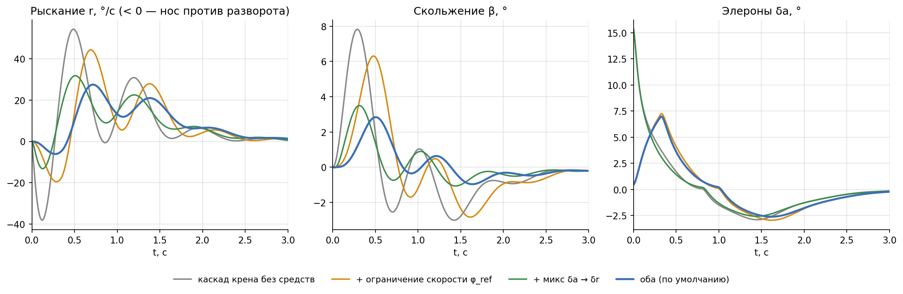

Ступенька курса 30° на 16 м/с:

| Вариант | Рывок носа, r min | max \|ṙ\| | β max | t_уст 5 % |
|---|---|---|---|---|
| каскад крена без средств | −38 °/с | 536 °/с² | 7.8° | 2.4 с |
| + ограничение скорости φ_ref | −20 | 269 | 6.3 | 2.5 |
| + микс δa → δr | −13 | 186 | 3.5 | 2.4 |
| **оба (по умолчанию)** | **−6** | **131** | **2.8** | 2.5 |

Cn_δa оценён на крейсерском CL = 0.28 и по модулю растёт с CL. На малой скорости микс
недокомпенсирует, остаток добирает контур β (β max 4.7° на 12 м/с).

---

## 7. Защита по углу атаки

Класс `AngleOfAttackProtector` (`control/aua.py`) — надзорный уровень над тангажом. Стоит
между внешним продольным контуром и тангажом: получает θ_cmd и балансировочный газ и
может их заменить. Нужен датчик α — зонд (`TruthSensors` его дают, `NoisySensors` — с
флагом `alpha_probe=True`). Включена на стенде, в остальных программах `prot = None`.

### 7.1 Автомат состояний

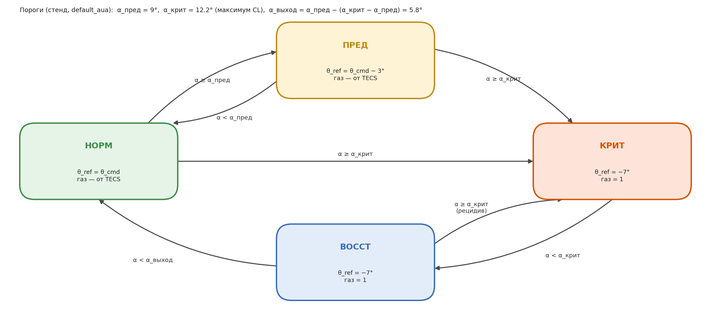

| Состояние | Когда | Что делает |
|---|---|---|
| НОРМ | α < α_пред | пропускает θ_cmd и газ без изменений |
| ПРЕД | α_пред ≤ α < α_крит | опускает уставку тангажа на 3° |
| КРИТ | α ≥ α_крит | перехват: θ_ref = −7°, газ = 1 |
| ВОССТ | после КРИТ, пока α ≥ α_выход | держит перехват; при α ≥ α_крит — снова КРИТ |

Гистерезис (α_выход < α_пред) нужен, чтобы автомат не возвращался в НОРМ внутри зоны
предупреждения и не «дребезжал».

**Пороги.** Стенд берёт их из параметров ЛА (`default_aua`): α_пред = 9°,
α_крит = 12.2° (максимум CL), α_выход = α_пред − (α_крит − α_пред) = 5.8°. Умолчания
самого `AUAParams` (15° / 20° / 10°) остались от прежнего ЛА (Aerosonde) — для FPV их
нужно задавать явно, как на стенде.

### 7.2 Демонстрация: режим «Срыв»

Режим «Срыв» стенда отключает внешний продольный контур: газ 0, θ_ref = +15°. Скорость
падает, угол атаки растёт.

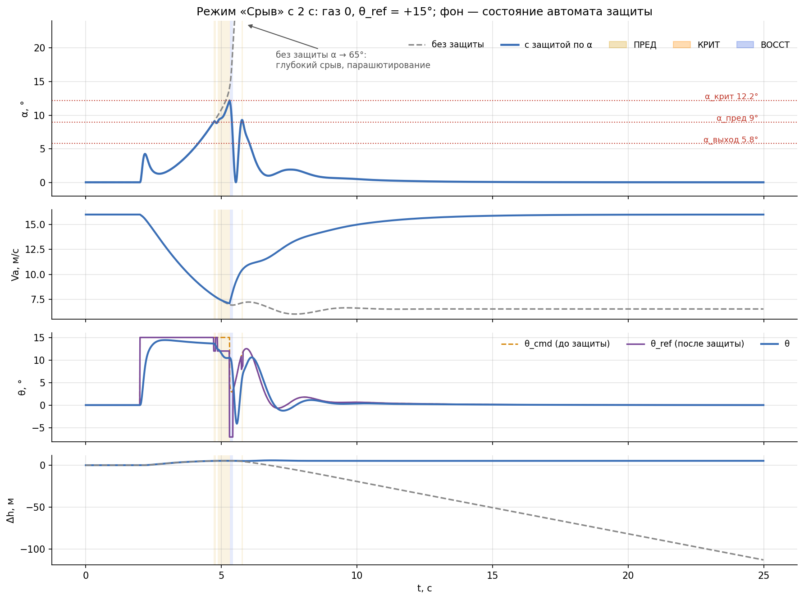

- **С защитой:** на 4.7 с α проходит 9° (ПРЕД — уставка тангажа на 3° ниже), на 5.3 с —
  12.2° (КРИТ — нос вниз, газ полный). Перехват длится всего 0.12 с: угол атаки сразу
  падает ниже α_выход. Угол атаки не превысил 12.2°, скорость упала до 7.1 м/с и
  восстановилась; стенд переводит САУ в удержание высоты, на которой сработала защита,
  — высота не потеряна.
- **Без защиты:** α уходит в закритическую область до 74° и устанавливается около 65° —
  глубокий срыв: ЛА парашютирует со скоростью ~6.5 м/с и теряет 6.3 м высоты в секунду.

Порог КРИТ совпадает с максимумом CL, поэтому защита срабатывает уже на границе срыва.
Перехват по измеренному α — это и есть место, где прямое измерение угла атаки зондом
полезнее косвенной оценки (тема на паузе, [archive/probe/REPORT.md](../archive/probe/REPORT.md)).

---

## 8. Навигация по точкам

Класс `WaypointNavigator` (`control/navigation.py`), метод — B&M гл. 10–11. Навигатор
только формирует уставки для существующих контуров: путевой угол χ_ref, высоту h_ref,
кривизну κ (упреждение крена, раздел 6.1) и уклон участка (упреждение ḣ в TECS).

### 8.1 Следование по прямой и окружности

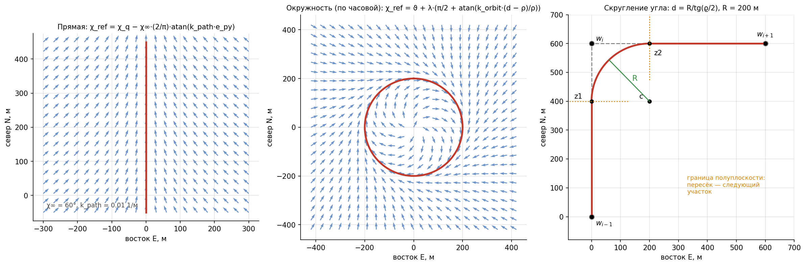

**Прямая** (B&M 10.1, векторное поле). Начало участка r, направление χ_q; e_py —
боковое отклонение от линии (> 0 — правее):

$$
e_{py} = -\sin\chi_q\,(p_N - r_N) + \cos\chi_q\,(p_E - r_E), \qquad
\chi_{ref} = \chi_q - \chi_\infty\,\frac{2}{\pi}\operatorname{arctg}(k_{path}\,e_{py})
$$

Далеко от линии ЛА идёт к ней под углом χ∞ = 60°; ближе ~1/k_path = 100 м плавно
ложится на неё. Угол упреждения сноса в ветре снимать не нужно — его даёт сам контур курса
по путевому углу.

**Окружность** (B&M 10.2), центр c, радиус ρ, λ = +1 — по часовой, −1 — против:

$$
d = |p - c|, \quad \vartheta = \operatorname{arctg2}(p_E - c_E,\; p_N - c_N), \qquad
\chi_{ref} = \vartheta + \lambda\Big(\frac{\pi}{2} + \operatorname{arctg}\frac{k_{orbit}(d - \rho)}{\rho}\Big)
$$

### 8.2 Менеджер маршрута

Маршрут — точки w₁…w_N (север, восток, высота). Углы маршрута **скругляются дугой**
радиуса R_fillet (B&M 11.2, алгоритм 6). Для угла у точки w_i:
q₀, q₁ — направления входящего и исходящего участков, ϱ = arccos(−q₀·q₁) — внутренний
угол.

1. Прямая w_{i−1} → w_i — до полуплоскости через z₁ = w_i − d·q₀, где d = R/tg(ϱ/2).
2. Дуга с центром c = w_i − (R/sin(ϱ/2))·орт(q₀ − q₁) — до полуплоскости через
   z₂ = w_i + d·q₁.
3. Прямая w_i → w_{i+1}.

ЛА проходит не через саму точку, а по дуге, зато не проскакивает поворот. Первая версия
без скругления (переключение у самой точки) проскакивала поворот 90° на ~R_min и через
15 с была всё ещё в ~95 м от новой линии. На остром угле или коротком участке вынос d
ограничен половиной участка — тогда радиус дуги меньше R.

- **Конец маршрута.** После последней точки — кружение радиусом R_orbit вокруг неё.
  Замкнутый маршрут (`loop = True`) — снова к первой точке.
- **Высота** на прямой меняется линейно по ходу участка от h_{i−1} к h_i, на дуге — h_i.
- **Правка маршрута в полёте** (`update_route`): цель — точка с тем же номером, участок к
  ней — от предыдущей точки нового маршрута; кружение остаётся кружением вокруг новой
  последней точки.

### 8.3 Параметры (`NavParams`)

| Параметр | Значение | Смысл |
|---|---|---|
| `chi_inf` | 60° | угол подхода к линии издалека |
| `k_path` | 0.01 1/м | масштаб выхода на линию, ~100 м |
| `k_orbit` | 2.0 | крутизна поля у окружности |
| `R_fillet` | 200 м | радиус скругления углов (0 — без скругления) |
| `R_orbit` | 200 м | радиус кружения у последней точки |
| `orbit_cw` | True | кружение по часовой |
| `loop` | False | замкнутый маршрут |

R_fillet и R_orbit должны быть больше минимального радиуса координированного
разворота по **путевой** скорости R_min = Vg²/(g·tg φ_max). Для FPV при φ_max = 30°:
45 м на 16 м/с в штиль, 78 м при попутном ветре 5 м/с. Умолчания 200 м подбирались для
прежнего ЛА (30 м/с, R_min ≈ 160 м) и для FPV с запасом.

### 8.4 Полёт по маршруту

Маршрут сценария s10: (1000, 0, 100) → (1000, 1000, 130) → (0, 1000, 130) → (600, 300, 100),
старт из начала координат на север, затем кружение. Шум датчиков включён; отклонение
посчитано по **истинному** положению.

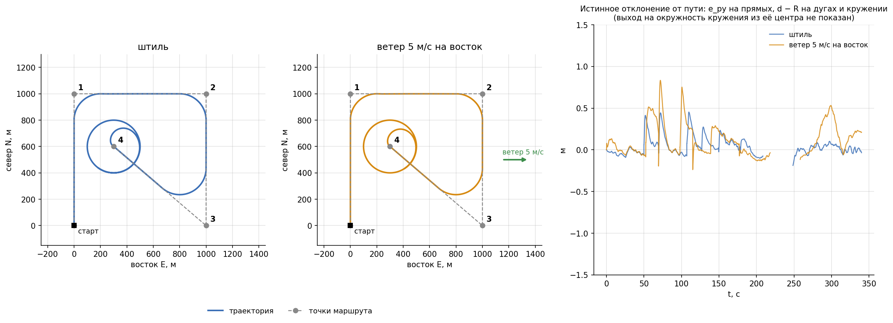

| Величина | Штиль | Ветер 5 м/с на восток |
|---|---|---|
| \|e_py\| max на прямых (10 с после входа отброшены) | 0.1 м | 0.2 м |
| \|d − R\| max на дугах R = 200 м | 0.5 м | 0.8 м |
| \|d − R\| max на кружении (после выхода на окружность) | 0.2 м | 0.5 м |
| \|h − h_ref\| в конце | 0.05 м | 0.05 м |

Навигатор видит положение по GPS с шумом σ = 1 м, поэтому по его собственной оценке e_py
«гуляет» до ±4.5 м — но ЛА этот шум почти не отрабатывает: истинное отклонение меньше
метра. На острый угол у точки 3 навигатор даёт скачок h_ref (дуга срезает угол, а высота
на прямой считается от точки) — TECS отрабатывает его снижением без потери скорости.

---

## 9. САУ одним классом — `SAU`

`control/sau.py`, РЕШ-26. Одна и та же САУ работает в сценариях, тренажёре и стенде;
раньше она была собрана трижды.

### 9.1 Звенья и интерфейсы

Каждое звено — отдельный объект; его можно заменить другим с тем же методом.

| Звено | Сейчас | Интерфейс | Что может встать на его место |
|---|---|---|---|
| `sensors` | `TruthSensors`, `NoisySensors` | `measure(t, state, Va, α, β) → meas` | частоты, задержки, дрейф гироскопа |
| `estimator` | нет: оценка = измерения | `update(meas, dt) → est` | комплементарный фильтр, EKF |
| `nav` | `WaypointNavigator` | `step(pn, pe, χ) → (χ_ref, h_ref)` или None; `.kappa`, `.h_slope`, `.chi_q` | L1 / NPFG, траектории Дубинса |
| `lon` | `TECS` или `AltSpeedHold` | `step(refs, est, dt, hold_alt) → (θ_cmd, δt)`; `reset()`, `reset_alt()`, `thr_trim` | — |
| `prot` | `AngleOfAttackProtector` или None | `step(α, θ_cmd, δt*, dt) → AUAOutput` | — |
| `pitch` | `PitchController` | `set_pitch_setpoint(θ)`, `step(t, meas, dt)` | тангаж по схеме крена (θ → q_ref → FF + ПИ) с упреждением q в развороте |
| `lat` | `LateralController` (`lat.roll` — `RollController`) | `set_course(χ, κ)`, `step(meas, dt) → (δa, δr)` | INDI по крену вместо `lat.roll` |
| весь `_control` | каскад | подкласс `SAU` | LQR / LQI, INDI, NMPC — для сравнения с каскадом |

Ключи словарей `meas` / `est`: `t, h, hdot, Va, q, p, theta, phi, chi, Vg, beta` и по
флагам `alpha, pn, pe` (подробно — [SENSORS.md](SENSORS.md)).

### 9.2 Использование

```python
from runner import compute_trim
from control.sau import SAU, SAUParams, NoisySensors, TruthSensors, Mode
from control.navigation import WaypointNavigator

trim = compute_trim(aircraft, 16.0)                       # (α*, δe*, δt*)
sau = SAU(aircraft, trim, TruthSensors(), SAUParams(), nav=WaypointNavigator())
sau.engage(theta=trim[0], h=100.0, Va=16.0, chi=0.0)      # уставки = текущий режим
sau.set_mode(Mode.ALTITUDE)
sau.refs.h, sau.refs.chi = 150.0, np.radians(90)          # новые уставки

def controls_fn(t, state, Va, alpha):                     # для runner.run()
    beta = air_data(state, wind(state[H], t, wp))[2]
    return sau.step(t, state, Va, alpha, beta, dt)
```

- `engage(θ, h, Va, χ)` — включение: уставки равны текущему режиму, интегралы с нуля.
- `set_mode(m)` — смена режима: интеграл высоты с нуля; при переходе в `PITCH` уставка
  тангажа подхватывает последнюю команду внешнего контура — без скачка.
- `fly_route(точки, старт)` — маршрут с первой точки, режим `ROUTE`.
- После шага доступны для журнала и окна стенда: `est`, `theta_cmd` (до защиты),
  `theta_ref` (после), `prot_out`, `controls`.

Взлёт, посадка, возврат домой — это новые значения `Mode` и ветки в `_guidance` /
`_outer`.

**Проверка перехода на `SAU`:** s8–s10 — текстовый вывод и все массивы `.flightlog`
совпали с прежними до бита; тренажёр и стенд — прежний код против `SAU` на истинных
измерениях, 120 с со всеми режимами, маршрутом, защитой и «Срывом»: расхождение 0.0.

---

## 10. LQR

`control/lqr.py`, сценарий s7 (набор → горизонт → снижение) — альтернатива продольному
каскаду для сравнения.

- Модель — численная линеаризация `derivatives()` в точке балансировки по
  [u, w, q, θ] и [δe, δt], дискретизация Эйлером с шагом dt.
- Усиление K — из дискретного уравнения Риккати (`scipy.linalg.solve_discrete_are`;
  scipy — согласованное исключение из правила «только numpy»).
- Веса: Q = diag(1, 1, 10, 20) по [Δu, Δw, Δq, Δθ], R = diag(150, 1) по [Δδe, Δδt].
- Высота — внешний П-контур θ_ref = θ* + 0.05·(h_ref − h), ±25°; уставка состояния
  x_ref = [Va·cos θ_ref, Va·sin θ_ref, 0, θ_ref]; закон δ = δ* − K·(x − x_ref).
- Регулятор считается при запуске по текущей модели ЛА — отдельного расчёта в
  `tuning.py` не нужно. Измерения u, w в s7 восстанавливаются из Va и θ.

---

## 11. Проверки

| Проверка | Что проверяет |
|---|---|
| `checks/check_sau.py` | умолчания регуляторов = расчёт `tuning.py`; ступеньки тангажа, высоты, скорости, крена, курса, TECS на полной модели против теории; большой манёвр; режимы как в тренажёре |
| `checks/check.py`, раздел 8 | знаки и логика боковой САУ |
| `checks/check_blocks.py` | схемы конструктора из блоков совпадают с регуляторами |
| `docs/figures/sau_plots.py` | все графики и таблицы этого документа |

Сводка переходных процессов (полная модель, датчики без шума, 16 м/с):

| Контур, ступенька | Перерегулирование, мод. / теор. | t_уст 5 %, мод. / теор. |
|---|---|---|
| тангаж +3° | 0 / 1.5 % | 0.61 / 0.22 с |
| крен 20° → 0 | 0.3 / 0 % | 0.69 / 0.71 с |
| курс +20° | 0 / 0 % | 2.31 / 2.38 с |
| TECS: высота +5 м | 0 / 0 % | 6.1 / 6.0 с |
| TECS: скорость 16 → 18 м/с | 0 / 0 % | 6.8 / 6.0 с |
| раздельные: высота +5 м | 5.4 / 7.6 % | 3.3 / 6.4 с |
| раздельные: скорость 16 → 18 м/с | 8.7 / 8.7 % | 4.0 / 4.0 с |

Режимы как в 3D-тренажёре (`check_sau.py`): на 26 м/с высота +100 м и затем −150 м
отработана точно (300.0 / 150.0 м), α ≤ 3.9°; серия разворотов +90° → −90° → −45° —
|φ| ≤ 30.2° при пределе уставки 30°, |Δh| ≤ 0.5 м.

---

## 12. Ограничения и что дальше

- **Одна точка настройки.** Коэффициенты рассчитаны на 16 м/с. Масштаб по скорости есть у
  руля высоты и элеронов, таблицы балансировки — у TECS; полосы внешних контуров по
  скорости не масштабируются. Далеко от 16 м/с — пересчитать `design_sau(aircraft, Va)`.
- **Нет оценки состояния.** САУ работает прямо по измерениям; шум барометра проходит в
  уставку тангажа через упреждение TECS ([SENSORS.md](SENSORS.md), раздел 5).
- **Тангаж — каскад П-звеньев** без упреждения q в развороте: в крене ЛА немного теряет
  высоту, остаток снимает TECS.
- **Защита по α** отвечает только за продольный канал; в развороте с большим креном
  перегрузка и α растут, а уставка крена не ограничивается по α.
- **Навигация** — векторные поля B&M; L1 / NPFG и траектории Дубинса — дорожная карта.

Дорожная карта — [DEV_PLAN.md](DEV_PLAN.md); почему сделано так — [decisions.md](decisions.md)
(РЕШ-21…23, 26, 27). Результаты на прежнем ЛА (Aerosonde, 30 м/с) и прежняя структура
боковой САУ — тег git `diploma` и [scenarios_report.md](scenarios_report.md).
