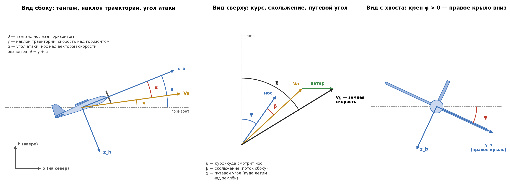
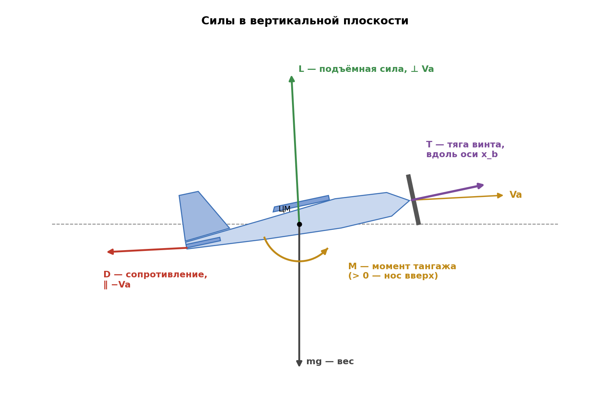
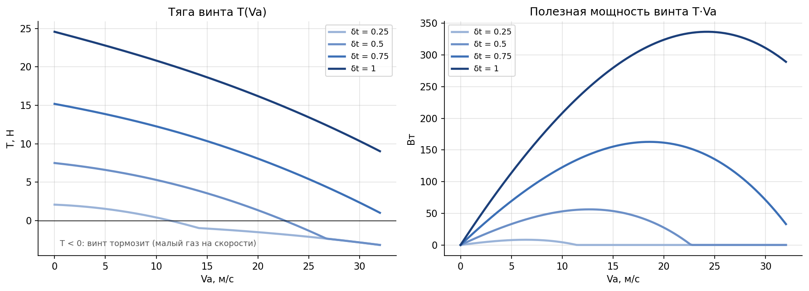
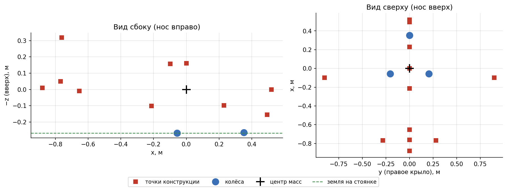
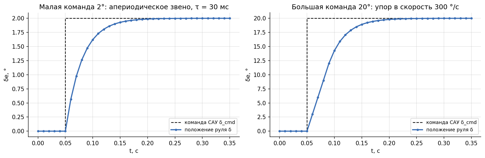
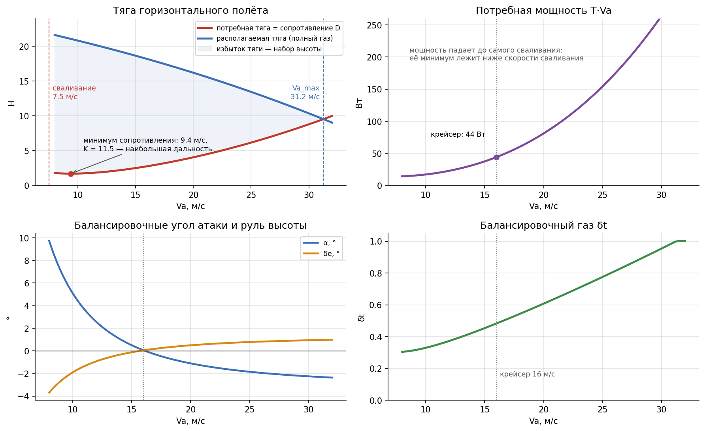

# Модель полёта

Справочник по физической модели симулятора: системы координат, уравнения движения,
силы и моменты, силовая установка, шасси, приводы рулей, балансировка, численное
интегрирование. Аэродинамические коэффициенты — в [aerodynamics.md](aerodynamics.md).

Модель — полная нелинейная модель движения твёрдого тела с шестью степенями свободы
(6DOF) по учебнику R. Beard, T. McLain «Small Unmanned Aircraft: Theory and Practice»
(далее B&M), гл. 3–4, с поправками проекта (они помечены, обоснования — в
[decisions.md](decisions.md)).

| Модуль | Что в нём |
|---|---|
| `sim/state.py` | вектор состояния, матрица поворота, воздушная скорость и аэродинамические углы |
| `sim/dynamics.py` | `derivatives()` — правые части уравнений движения; `propeller()` — мотор и винт |
| `sim/aero.py` | аэродинамические силы и моменты |
| `sim/wind.py` | ветер: постоянный, порыв, сдвиг по высоте; `make_wind_fn()` |
| `sim/turbulence.py` | турбулентность Драйдена |
| `sim/ground.py` | контакт с землёй: колёса и точки конструкции |
| `sim/actuators.py` | приводы рулей |
| `sim/integrators.py` | интеграторы RK4 и Эйлера |
| `runner.py` | главный цикл, балансировка |

Все числа ниже — для аппарата по умолчанию (FPV-самолёт, `AircraftParams()`), если не
сказано иное. Результаты — моделирование, не эксперимент.

---

## 1. Системы координат и углы



### 1.1 Земная система координат

Правая система «север — восток — вниз» (NED), но высота хранится со знаком «вверх»:

| Ось | Направление | В векторе состояния |
|---|---|---|
| x | на север | `X` |
| y | на восток | `Y` |
| h | вверх (h = −z<sub>NED</sub>) | `H` |

Ветер задаётся тройкой `(Vwx, Vwh, Vwy)` — скорость воздушной массы на север, вверх и
на восток. Порядок «север, вверх, восток» исторический: боковая составляющая дописана
последней, и продольный код с парой `(Vwx, Vwh)` не менялся.

### 1.2 Связанная система координат

Жёстко связана с самолётом: **x<sub>b</sub>** — к носу, **y<sub>b</sub>** — на правое
крыло, **z<sub>b</sub>** — вниз. В ней записаны скорости `(u, v, w)`, угловые скорости
`(p, q, r)` и уравнения динамики.

### 1.3 Углы Эйлера

Ориентация задаётся тремя поворотами в порядке ψ → θ → φ:

| Угол | Название | Положительный, когда |
|---|---|---|
| ψ | курс (рыскание) | нос повернул вправо от севера |
| θ | тангаж | нос выше горизонта |
| φ | крен | правое крыло опущено |

Матрица перехода из связанной системы в земную ($s_x = \sin x$, $c_x = \cos x$):

$$
R_{b\to e} =
\begin{pmatrix}
c_\theta c_\psi & s_\phi s_\theta c_\psi - c_\phi s_\psi & c_\phi s_\theta c_\psi + s_\phi s_\psi \\
c_\theta s_\psi & s_\phi s_\theta s_\psi + c_\phi c_\psi & c_\phi s_\theta s_\psi - s_\phi c_\psi \\
-s_\theta & s_\phi c_\theta & c_\phi c_\theta
\end{pmatrix}
$$

Обратный переход — транспонированная матрица $R^{T}$.

### 1.4 Воздушная скорость, угол атаки и угол скольжения

Аэродинамика зависит от движения **относительно воздуха**, а не земли. Ветер
переводится в связанную систему, и из скорости самолёта вычитается скорость воздуха:

$$
\begin{pmatrix} u_w \\ v_w \\ w_w \end{pmatrix} = R^{T}
\begin{pmatrix} V_{wx} \\ V_{wy} \\ -V_{wh} \end{pmatrix},
\qquad
u_r = u - u_w,\quad v_r = v - v_w,\quad w_r = w - w_w
$$

$$
V_a = \sqrt{u_r^2 + v_r^2 + w_r^2},\qquad
\alpha = \operatorname{arctg}\frac{w_r}{u_r},\qquad
\beta = \arcsin\frac{v_r}{V_a}
$$

- **Угол атаки α** — угол между продольной осью и вектором воздушной скорости в
  плоскости симметрии.
- **Угол скольжения β** > 0, когда поток набегает справа.
- **Путевой угол χ** — направление земной скорости; при ветре он отличается от курса ψ
  на угол сноса. Его измеряет GPS, поэтому по нему САУ держит линию пути.

Без ветра и крена $\theta = \gamma + \alpha$, где γ — наклон траектории. При ветре это
равенство нарушается — поэтому угол атаки нельзя точно оценить по тангажу и GPS.

---

## 2. Вектор состояния и управление

```
state = [u, w, q, θ, x, h,  v, p, r, φ, ψ, y]
         └─ продольные ──┘  └─── боковые ───┘
```

| № | Имя | Величина | Ед. |
|---|---|---|---|
| 0 | `U` | скорость вдоль x<sub>b</sub> | м/с |
| 1 | `W` | скорость вдоль z<sub>b</sub> | м/с |
| 2 | `Q` | угловая скорость тангажа | рад/с |
| 3 | `THETA` | тангаж θ | рад |
| 4 | `X` | координата на север | м |
| 5 | `H` | высота | м |
| 6 | `V` | скорость вдоль y<sub>b</sub> | м/с |
| 7 | `P` | угловая скорость крена | рад/с |
| 8 | `R` | угловая скорость рыскания | рад/с |
| 9 | `PHI` | крен φ | рад |
| 10 | `PSI` | курс ψ | рад |
| 11 | `Y` | координата на восток | м |

Первые шесть — продольное движение; боковое дописано после них, поэтому продольный код
не зависит от бокового. В коде обращение только по имени: `state[THETA]`, а не `state[3]`.

**Управление** — `[δe, δt, δa, δr]` (индексы `DE`, `DT`, `DA`, `DR`): руль высоты, газ
(0…1), элероны, руль направления; рули — в радианах, упоры ±25°. Если закон управления
возвращает только `[δe, δt]`, элероны и руль направления равны нулю.

| Руль | Положительное отклонение | Действие |
|---|---|---|
| δe | задняя кромка руля высоты вниз | нос вниз |
| δa | правый элерон вверх, левый вниз | крен вправо |
| δr | задняя кромка руля направления влево | нос влево |

---

## 3. Уравнения движения

Реализованы в `sim/dynamics.derivatives(state, controls, t, params, wind_fn)` — чистой
функции: она только вычисляет производные и ничего не меняет снаружи (B&M ур. 3.14–3.17).

### 3.1 Поступательное движение

Второй закон Ньютона во вращающейся связанной системе:

$$
\dot u = r v - q w + \frac{f_x}{m},\qquad
\dot v = p w - r u + \frac{f_y}{m},\qquad
\dot w = q u - p v + \frac{f_z}{m}
$$

$(f_x, f_y, f_z)$ — сумма аэродинамических сил, тяги, веса и (на земле) реакций.
Перекрёстные члены появляются потому, что скорости записаны во вращающейся системе.

### 3.2 Вращательное движение

Уравнения Эйлера для самолёта, симметричного относительно плоскости x<sub>b</sub>z<sub>b</sub>
($J_{xy} = J_{yz} = 0$):

$$
\begin{aligned}
\dot p &= \Gamma_1 p q - \Gamma_2 q r + \Gamma_3 L + \Gamma_4 N \\
\dot q &= \Gamma_5 p r - \Gamma_6 (p^2 - r^2) + \frac{M}{J_y} \\
\dot r &= \Gamma_7 p q - \Gamma_1 q r + \Gamma_4 L + \Gamma_8 N
\end{aligned}
$$

$L, M, N$ — моменты крена, тангажа и рыскания. Коэффициенты:

$$
\Gamma = J_x J_z - J_{xz}^2,\quad
\Gamma_1 = \frac{J_{xz}(J_x - J_y + J_z)}{\Gamma},\quad
\Gamma_2 = \frac{J_z(J_z - J_y) + J_{xz}^2}{\Gamma},\quad
\Gamma_3 = \frac{J_z}{\Gamma},\quad
\Gamma_4 = \frac{J_{xz}}{\Gamma}
$$

$$
\Gamma_5 = \frac{J_z - J_x}{J_y},\quad
\Gamma_6 = \frac{J_{xz}}{J_y},\quad
\Gamma_7 = \frac{(J_x - J_y) J_x + J_{xz}^2}{\Gamma},\quad
\Gamma_8 = \frac{J_x}{\Gamma}
$$

У FPV-самолёта $J_x = 0.101$, $J_y = 0.104$, $J_z = 0.171$ кг·м², $J_{xz} = 0$: крен и
рыскание связаны только через аэродинамику.

### 3.3 Кинематика углов

$$
\dot\phi = p + (q\sin\phi + r\cos\phi)\operatorname{tg}\theta,\qquad
\dot\theta = q\cos\phi - r\sin\phi,\qquad
\dot\psi = \frac{q\sin\phi + r\cos\phi}{\cos\theta}
$$

При θ = ±90° уравнения вырождаются — для самолёта это вне рабочей области. В
3D-тренажёре после каждого шага углы приводятся к виду φ, ψ ∈ [−180°, 180°),
θ ∈ [−90°, 90°], чтобы после фигур пилотажа они не накапливались.

### 3.4 Кинематика положения

Земная скорость — связанная скорость, повёрнутая в земную систему:

$$
\begin{pmatrix} \dot x \\ \dot y \\ -\dot h \end{pmatrix} = R_{b\to e}
\begin{pmatrix} u \\ v \\ w \end{pmatrix}
$$

### 3.5 Частный случай: только продольное движение

При $v = p = r = \phi = \psi = 0$ и $\delta_a = \delta_r = 0$ уравнения превращаются в
классические продольные:

$$
\dot u = -q w + \frac{f_x}{m},\quad
\dot w = q u + \frac{f_z}{m},\quad
\dot q = \frac{M}{J_y},\quad
\dot\theta = q,\quad
\dot x = u\cos\theta + w\sin\theta,\quad
\dot h = u\sin\theta - w\cos\theta
$$

`checks/check.py` (раздел 7) проверяет, что полная модель в этом случае совпадает с
продольной.

---

## 4. Силы и моменты



### 4.1 Вес

В связанной системе:

$$
f_x^{g} = -mg\sin\theta,\qquad f_y^{g} = mg\cos\theta\sin\phi,\qquad f_z^{g} = mg\cos\theta\cos\phi
$$

### 4.2 Аэродинамика

Подъёмная сила $L$ перпендикулярна воздушной скорости, сопротивление $D$ направлено
против неё; в связанную систему они переводятся поворотом на угол атаки:

$$
f_x^{a} = -D\cos\alpha + L\sin\alpha,\qquad f_z^{a} = -D\sin\alpha - L\cos\alpha
$$

$$
L = \bar q S\, C_L,\quad D = \bar q S\, C_D,\quad M = \bar q S c\, C_m,\qquad \bar q = \tfrac12 \rho V_a^2
$$

Боковая сила и моменты крена и рыскания:

$$
f_y^{a} = \bar q S\, C_Y,\qquad L_{roll} = \bar q S b\, C_{roll},\qquad N = \bar q S b\, C_n
$$

Коэффициенты $C_L, C_D, C_m, C_Y, C_{roll}, C_n$ и их зависимость от α, β, угловых
скоростей и рулей — в [aerodynamics.md](aerodynamics.md). Момент крена обозначен
$C_{roll}$ (в B&M — $C_l$), чтобы не путать его с коэффициентом подъёмной силы.

### 4.3 Мотор и винт

Тянущий винт с электромотором (B&M 2-е изд., разд. 4.3). Тяга направлена вдоль оси
x<sub>b</sub>. Газ задаёт напряжение на моторе $V_{in} = V_{max}\,\delta_t$; обороты Ω —
положительный корень баланса моментов мотора и винта:

$$
\frac{\rho D^5 C_{Q0}}{(2\pi)^2}\,\Omega^2
+ \Big(\frac{\rho D^4 C_{Q1}}{2\pi} V_a + \frac{K_Q K_V}{R}\Big)\Omega
+ \Big(\rho D^3 C_{Q2} V_a^2 - \frac{K_Q V_{in}}{R} + K_Q i_0\Big) = 0
$$

$$
J = \frac{2\pi V_a}{\Omega D},\qquad
C_T = C_{T2} J^2 + C_{T1} J + C_{T0},\qquad
T = \rho \Big(\frac{\Omega}{2\pi}\Big)^2 D^4 C_T,\qquad
Q_p = \rho \Big(\frac{\Omega}{2\pi}\Big)^2 D^5 C_Q
$$

где $K_V = K_Q = 60/(2\pi\cdot KV)$ — постоянные мотора, $R$ — сопротивление обмотки,
$i_0$ — ток холостого хода, $J$ — относительная поступь винта.

**Поправка проекта — свободное вращение.** Регулятор оборотов не возвращает энергию в
батарею: ток мотора $i = (V_{in} - K_V\Omega)/R$ не бывает отрицательным. Если на малом
газе и большой скорости уравнение даёт $i < 0$, мотор считается отключённым, винт
вращается набегающим потоком, на валу только трение $K_Q i_0$. Без этой поправки сброс
газа означал бы короткое замыкание обмотки и торможение винтом в несколько раз сильнее
реального.

Реактивный момент винта $-Q_p$ добавляется к моменту крена — поэтому самолёт без
управления медленно кренится.



| Параметр FPV | Значение | Источник |
|---|---|---|
| винт | APC 11×7E, D = 0.279 м | коэффициенты $C_T(J)$, $C_Q(J)$ — продувка UIUC |
| мотор | T-Motor AT2814 900KV: R = 0.082 Ом, i₀ = 1.2 А | паспорт |
| батарея | 4S, V<sub>max</sub> = 14.8 В | — |
| статическая тяга | 24.6 Н, тяговооружённость 1.25 | расчёт по модели |

На малом газе и большой скорости тяга отрицательна: винт тормозит самолёт.

### 4.4 Суммарные силы

$$
f_x = f_x^{a} + T + f_x^{g} + f_x^{gnd},\qquad
f_y = f_y^{a} + f_y^{g} + f_y^{gnd},\qquad
f_z = f_z^{a} + f_z^{g} + f_z^{gnd}
$$

Реакции земли $f^{gnd}$ (раздел 5) есть только там, где задана поверхность — в
3D-тренажёре, стенде и конструкторе. В сценариях s1–s10 земли нет.

### 4.5 Ветер и турбулентность Драйдена

Ветер входит в уравнения только через воздушную скорость (раздел 1.4): аэродинамика
считается по $\mathbf{V}_a = \mathbf{V}_g - \mathbf{V}_w$. Вектор ветра в земной СК
(север, вверх, восток) — сумма составляющих `sim/wind.py`: постоянный ветер, сдвиг по
высоте, прямоугольный порыв и турбулентность.

**Турбулентность** (`sim/turbulence.py`, B&M разд. 4.4) — белый шум единичной
интенсивности на входе формирующих фильтров Драйдена:

$$
H_u(s) = \sigma_u\sqrt{\frac{2V_a}{L_u}}\,\frac{1}{s + V_a/L_u},\qquad
H_{v}(s) = \sigma_{v}\sqrt{\frac{3V_a}{L_{v}}}\,
\frac{s + V_a/(\sqrt{3}L_{v})}{(s + V_a/L_{v})^2},
$$

$H_w$ — как $H_v$ с $L_w$, $\sigma_w$. Здесь $L$ — масштаб турбулентности, м; $\sigma$ —
СКО скорости порыва, м/с; $V_a/L$ — частота излома спектра, рад/с (при Va = 16 м/с и
L = 200 м — 0.08 рад/с: горизонтальный порыв меняется за десятки секунд; вертикальный
при L = 50 м — в 4 раза быстрее). Дисперсия выхода каждого фильтра равна $\sigma^2$.

Параметры — таблица 4.1 B&M:

| Уровень (`turb_alt` / `turb_level`) | Высота | $L_u = L_v$, м | $L_w$, м | $\sigma_u = \sigma_v$, м/с | $\sigma_w$, м/с |
|---|---|---|---|---|---|
| low / light (слабая) | 50 м | 200 | 50 | 1.06 | 0.7 |
| low / moderate (умеренная) | 50 м | 200 | 50 | 2.12 | 1.4 |
| medium / light | 600 м | 533 | 533 | 1.5 | 1.5 |
| medium / moderate | 600 м | 533 | 533 | 3.0 | 3.0 |

**Упрощения (решение автора, РЕШ-30):**
1. Порывы заданы в **земных осях**, а не в связанных, как у B&M: $u_g$ — на север
   (спектр $H_u$), $v_g$ — на восток ($H_v$), $w_g$ — вверх ($H_w$). Ветер остаётся
   функцией $(h, t)$ и не зависит от ориентации ЛА. Следствие: продольный и поперечный
   спектры привязаны к сторонам света, а не к направлению полёта; при $L_u = L_v$ и
   $\sigma_u = \sigma_v$ различие — только в форме спектра выше частоты излома.
2. Фильтры рассчитаны на постоянную скорость `turb_Va` = 16 м/с (крейсер), а не на
   текущую Va.
3. Параметры таблицы взяты для фиксированных высот (50 и 600 м), без зависимости от
   высоты в полёте (MIL-F-8785C задаёт $L(h)$, $\sigma(h)$ — не реализовано). Угловая
   турбулентность ($p_g, q_g, r_g$) не моделируется: порыв одинаков по всему размаху.

**Численная реализация.** Фильтры записаны в пространстве состояний
$\dot x = A x + B\eta$, порыв $= C x$, и проинтегрированы методом Эйлера — Маруямы на
сетке `turb_dt` = 0.01 с: $x_{k+1} = (I + A\,\Delta t)\,x_k + B\sqrt{\Delta t}\,n_k$,
$n_k \sim N(0, 1)$. При $\Delta t \cdot V_a/L \le 0.003$ погрешность дискретизации
пренебрежимо мала. Между узлами сетки — линейная интерполяция, поэтому подшаги RK4
видят одно и то же поле, а одно $t$ всегда даёт одно значение. Ряд достраивается по мере
роста $t$. Момент включения $t_0$: до него порыв нулевой, после — фильтры стартуют из
нуля (включение клавишей T в 3D — без скачка ветра). Seed — `turb_seed`.

**Проверка** (`checks/check_turbulence.py`, моделирование): СКО по осям совпадают с
таблицей с точностью 4 % (5 × 4000 с); СПМ ряда в полосе 0.05…20 рад/с — 0.94…1.07 от
$|H(j\omega)|^2$ (`checks/turbulence_psd.png`). Реакция замкнутого контура (FPV, SAU —
TECS + курс, Va = 16 м/с, h = 100 м, 120 с, шум датчиков `SensorParams()`):

| Турбулентность | σh, м | max \|Δh\|, м | Va min…max, м/с | α max, ° | max \|φ\|, ° |
|---|---|---|---|---|---|
| нет | 0.03 | 0.12 | 15.9…16.1 | 0.4 | 0.3 |
| слабая | 0.39 | 1.2 | 15.1…16.8 | 2.4 | 0.8 |
| умеренная | 0.83 | 3.2 | 14.3…17.9 | 4.6 | 2.4 |

Малая реакция по крену — следствие упрощения 3: без угловой турбулентности порыв не
создаёт момента крена напрямую.

Где включается: только в 3D-режимах (`--turb light|moderate`, `--turb-alt low|medium`,
клавиша T в полёте); в сценариях s1–s10 турбулентность выключена (`turb_level = "off"`).

---

## 5. Земля и шасси

Самолёт касается земли **колёсами** (трёхопорное шасси с носовым колесом) и **точками
конструкции** (винт, днище, хвост, законцовки, оперение). Координаты точек — в
`AircraftParams.gear_wheels` и `gear_hard` (связанная система, от центра масс).



Поверхность — функция высоты $h_g(x, y)$, которую задаёт карта. Для каждой точки
считаются заглубление $d$ по нормали к земле и скорость точки; реакция — пружина с
демпфером, без «прилипания»:

$$
N = \max(0,\; k\,d - c\,v_n)
$$

Сила трения:

- **колесо** — малое сопротивление качению вдоль колеса ($\mu_{roll} = 0.05$) и большое
  боковое сцепление ($\mu_{side} = 0.8$); носовое колесо поворачивается вместе с рулём
  направления;
- **конструкция** — скольжение с $\mu_{slide} = 0.5$.

Сухое трение сглажено около нулевой скорости (иначе сила разрывна и уравнения не
решаются шагом 0.01 с). Силы точек переводятся в связанную систему и добавляются к
силам; их моменты относительно центра масс — к моментам.

| Параметр | Значение |
|---|---|
| жёсткость, демпфирование на точку | 1000 Н/м, 25 Н·с/м |
| осадка на стоянке | основные стойки 8.5 мм, носовая 2.7 мм |
| авария шасси | вертикальная скорость касания колесом > 3 м/с |

Тормозов нет: на уклоне круче 2.9° самолёт скатывается. Аварию определяет программа
(тренажёр), а не модель: касание точкой конструкции, жёсткое касание колесом, вода.
Проверка — `checks/check_ground.py`: стоянка, разбег и взлёт, посадка, руление, уклоны.

---

## 6. Приводы рулей

Силы считаются по **положениям** рулей, а не по командам САУ. Каждый руль — апериодическое
звено с ограничением скорости перекладки и упорами:

$$
\dot\delta = \operatorname{clip}\Big(\frac{\delta_{cmd} - \delta}{\tau},\; -\dot\delta_{max},\; \dot\delta_{max}\Big),
\qquad |\delta_{cmd}| \le 25°
$$

Для FPV $\tau = 0.03$ с и $\dot\delta_{max} = 300$ °/с — типичный цифровой сервопривод
(оценка). Малые команды отрабатываются как звено первого порядка, большие — с постоянной
скоростью.



Положения рулей пересчитываются раз в такт САУ перед шагом интегрирования. Газ проходит
без задержки. `servo_tau = 0` и `servo_rate = inf` выключают приводы. В логе
`controls` — положения рулей, `controls_cmd` — команды САУ.

---

## 7. Балансировка

Балансировка — режим, в котором все производные скоростей и углов равны нулю:
прямолинейный горизонтальный полёт без крена. `runner.compute_trim(aircraft, Va)`
решает его так:

1. Подъёмная сила равна весу: $C_{L,req} = \dfrac{2mg}{\rho V_a^2 S}$.
2. Подъёмная сила и момент тангажа (линейная часть модели) дают систему для угла атаки и
   руля высоты:

$$
\begin{pmatrix} C_{L\alpha} & C_{L\delta_e} \\ C_{m\alpha} & C_{m\delta_e} \end{pmatrix}
\begin{pmatrix} \alpha \\ \delta_e \end{pmatrix} =
\begin{pmatrix} C_{L,req} - C_{L0} \\ -C_{m0} \end{pmatrix}
$$

3. Газ подбирается так, чтобы тяга равнялась сопротивлению (бисекцией — модель винта
   аналитически не обращается).

`trim_state(aircraft, cfg)` строит из этого начальный вектор состояния.



| Va, м/с | α, ° | δe, ° | δt | тяга, Н | мощность T·Va, Вт | качество K |
|---|---|---|---|---|---|---|
| 9 | 7.0 | −2.7 | 0.31 | 1.7 | 15 | 11.5 |
| 12 | 2.6 | −0.9 | 0.37 | 1.9 | 23 | 10.3 |
| **16** (крейсер) | **0.0** | **0.0** | **0.48** | **2.8** | **44** | **7.1** |
| 20 | −1.1 | 0.5 | 0.61 | 4.1 | 81 | 4.8 |
| 24 | −1.7 | 0.7 | 0.74 | 5.7 | 137 | 3.4 |
| 28 | −2.1 | 0.9 | 0.88 | 7.7 | 215 | 2.6 |

Скорость сваливания — 7.5 м/с, наибольшая скорость горизонтального полёта — 31 м/с.
Наименьшее сопротивление (наибольшая дальность) — около 9.4 м/с. Крейсерская скорость
16 м/с — решение автора (РЕШ-21): на ней настроена САУ, а установка горизонтального
оперения подобрана так, чтобы руль высоты здесь стоял в нуле.

**Ограничения.** Балансировка линейна по CL и Cm (без срыва) и только горизонтальная:
набор, снижение и вираж она не считает. Боковой баланс (элероны против реактивного
момента винта, около 0.3–0.5°) тоже не считается — в продольных сценариях крен держит
регулятор `RollHold`.

---

## 8. Численное интегрирование

Основной метод — Рунге-Кутта 4-го порядка (`step_rk4`), шаг по умолчанию 0.01 с; метод
Эйлера (`step_euler`) — для сравнения. Внутри шага управление **заморожено**: все четыре
вычисления производных идут с одними и теми же рулями. Так работает и цифровой
автопилот — команды обновляются раз в такт.

Один шаг главного цикла `runner.run()`:

1. ветер на текущей высоте и в текущий момент;
2. воздушная скорость, α, β;
3. закон управления → команды; приводы → положения рулей;
4. запись в лог;
5. шаг RK4.

Лог содержит состояние **до** шага и управление, **применённое** на этом шаге.

---

## 9. Механическая энергия

$$
E_{kin} = \tfrac12 m V^2,\qquad E_{pot} = m g h,\qquad E = E_{kin} + E_{pot}
$$

В установившемся горизонтальном полёте полная энергия постоянна (тяга равна
сопротивлению). Сценарий s1 использует это как проверку интегратора.

> В логе ($E_{kin}$ в `Log`) скорость берётся без учёта ветра, то есть относительно
> земли. При ветре это не энергия относительно воздуха — известный недочёт, он в
> [DEV_PLAN.md](DEV_PLAN.md).

---

## 10. Упрощения модели

| Упрощение | Что из этого следует |
|---|---|
| Боковая аэродинамика линейна по β, угловым скоростям и рулям | верна при малых скольжениях (до 10–15°) |
| β не влияет на продольные коэффициенты | погрешность при больших скольжениях |
| Момент тангажа и боковые коэффициенты после срыва не моделируются | сваливание видно по CL и CD, но не штопор |
| Плотность воздуха постоянна, сжимаемость не учтена | на малых высотах и скоростях БПЛА несущественно |
| Масса постоянна | для электрического самолёта верно |
| Тяга вдоль оси; у винта только реактивный момент | нет гироскопического момента винта и обдува оперения |
| $C_T(J)$, $C_Q(J)$ — квадратичная аппроксимация продувки до J ≈ 0.8 | за пределами — экстраполяция |
| Турбулентность Драйдена — в земных осях, фильтры на постоянной Va, L и σ по табл. 4.1 B&M без зависимости от высоты, без угловой турбулентности (раздел 4.5) | качественная картина; для оценки по нормам — MIL-F-8785C |
| Земля — точечные пружины, трение сглажено, нет тормозов и влияния земли на аэродинамику | разбег и посадка качественно; дистанции — оценка |
